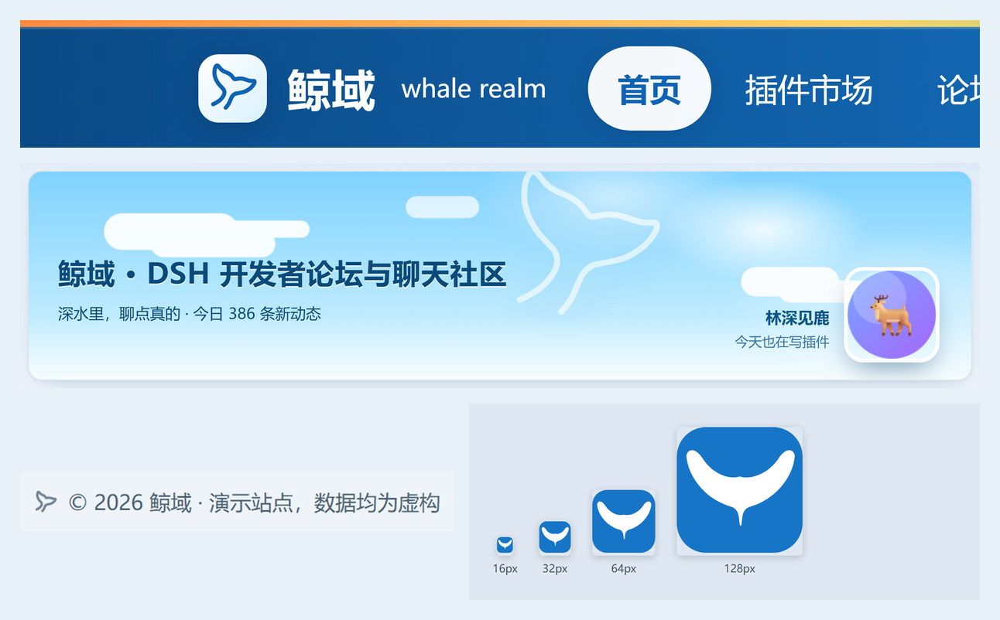
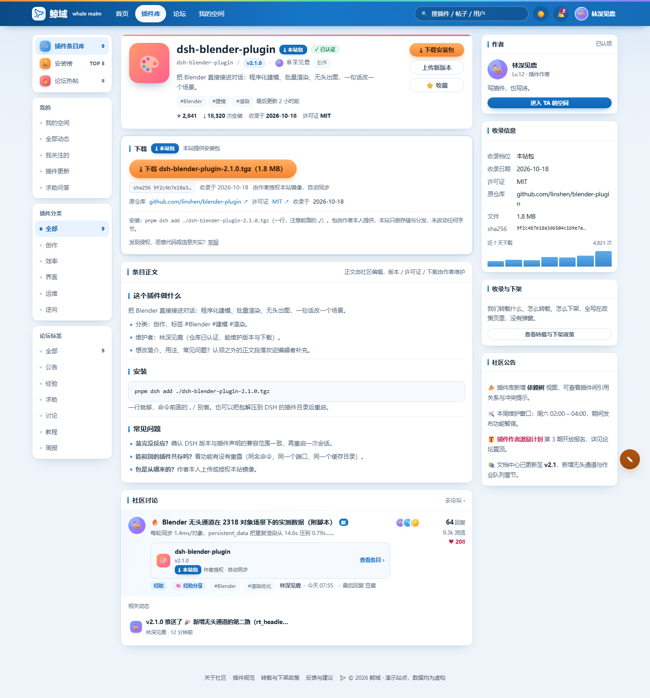
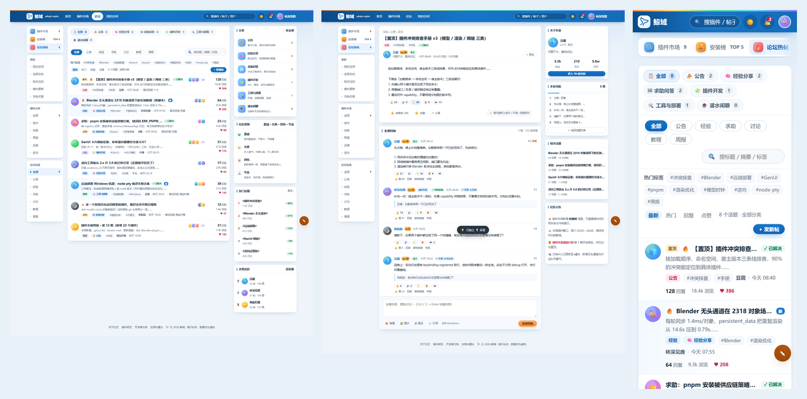

# WhaleRealm · 鲸域

> 一个仿 QQ 空间风格的开发者社区前端 —— 蓝白界面、插件条目库、社群、聊天、个人空间，外加一条完整的「条目 → 认领 → 授权 → 上传 → 下架」插件治理链路。

  

纯手写 HTML / CSS / JS：没有框架、没有 npm、没有网络请求，双击 `index.html` 就能跑。后端是可选的一份 Fastify + SQLite 实现，接了它才有真正的账号、发帖与图片上传。

## 这个仓库有什么

- **前端（根目录）**：`index.html` + `css/app.css` + `js/*.js`。全部演示数据在 `js/data.js`，状态存 localStorage，不接后端也能完整浏览。
- **登录页左卡（`whale/`）**：一张独立的鲸鱼娘互动卡，用 iframe 嵌进登录页，可拖动、可换片。素材片段不入库，见下方说明。
- **后端（`server/`）**：Fastify 4 + better-sqlite3（WAL），httpOnly Cookie + JWT，图片直传 COS（只签发预签名 URL），GIF 自动转 WebP 动图。
- **部署（`deploy/`）**：`build.mjs` 给静态资源加内容哈希，配 nginx / systemd / 云服务器初始化脚本，以及两份写给非运维的配置教程。



## 快速开始

```bash
# 方式一：直接打开
start index.html        # macOS 用 open，Linux 用 xdg-open

# 方式二：起个静态服务器（推荐，hash 深链更稳）
python -m http.server 8777 --bind 127.0.0.1
# 打开 http://127.0.0.1:8777/index.html
```

要跑后端：

```bash
cd server && npm install
cp .env.example .env      # 按注释填值；留空的项会走降级路径
npm start                 # http://127.0.0.1:3000
```

> 前端检测不到 `/api/*` 时会自动降级成纯演示模式（顶栏挂一条「离线」胶囊），功能照常可点。

## 关于鲸鱼娘卡片素材

`whale/clips-rand/` 里的 107 段 webm（约 60MB）是动画素材，不入库。缺了它登录页左卡只剩降级用的静态立绘 —— 卡本身、交互逻辑、随机池逻辑都在，把任意 `.webm` 片段按原名丢进 `whale/clips-rand/` 就能恢复。

## 目录结构

```
WhaleRealm/
├─ index.html            页面骨架 + 顶部彩色装饰条 + 右下浮动按钮
├─ css/app.css           全部样式（:root 变量 / 夜间皮肤 / 响应式）
├─ js/brand.js           品牌名 / 英文名 / 徽标字 / 标语 / 定位语
├─ js/data.js            全部演示数据（window.DATA）
├─ js/api.js             后端 API 封装（失败降级为纯演示数据）
├─ js/auth.js            登录 / 注册 / 三方授权 / 手机号认证（会话、单账号单会话、闸门数据源）
├─ js/app.js             渲染与交互（IIFE，hash 路由）
├─ js/default-avatar.js  随包默认头像的 dataURL 挂载点
├─ js/tags.js            标签目录的数据与检索
├─ assets/               默认头像（PNG + 内联用的 base64 文本）
├─ whale/                登录页左卡的鲸鱼娘互动卡（iframe 目标：index.html + assets + clips-rand）
│  └─ clips-rand/        107 段 webm 片段，约 60MB，不入库（见 .gitignore）
├─ deploy/               构建脚本 / nginx / systemd / 部署与配置教程
├─ server/               Fastify + better-sqlite3 后端
├─ docs/screenshots/     README 引用的三张拼图
└─ favicon.ico
```

> 开发期的 CDP 自检脚本（四十余个 `.cjs` / `.mjs`）与原始截图目录未随仓库发布：
> 它们依赖本机 Chrome profile 与写死的端口。测试方法与结果见 [自动化测试](#自动化测试)。

## 站点名

现用名 **鲸域**（whale realm），标语「深水里，聊点真的」。定位语（`desc`）已清空，头图与标题页只显示站名。
鲸 = 深水里的大块头，域 = 一片开阔的水面；比「坞」大气，社群与聊天两条腿都撑得住。

名字全部集中在 [js/brand.js](js/brand.js)，改一个字段即可全站跟着变（导航徽标、头图标题、讨论区卡片、页脚、标签页标题、meta description）。
`window.BRAND` 暴露的字段：

| 字段 | 值 | 用在哪 |
| --- | --- | --- |
| `name` | 鲸域 | 导航 logo、讨论区标题、页脚 © |
| `desc` | （空串） | 定位语；为空时 `full` 只等于 `name` |
| `full` | 鲸域 | 头图 h1、`<title>` |
| `en` | whale realm | logo 右侧小字 |
| `mark` | 鲸 | 备用文字徽标（导航已改用鲸尾矢量，见下节） |
| `slogan` | 深水里，聊点真的 | 头图副标题 |

历史候选仍保留在数组里，加参数即可预览对比（默认 0 = 鲸域）：

| 访问 | 名字 | 一句话定位 |
| --- | --- | --- |
| `index.html` | 鲸域 | **现用名**，大气且社群/聊天都能装 |
| `index.html?b=1` | 插件坞 | 停靠、聚集，插件味最正 |
| `index.html?b=2` | 插件巷 | 市井烟火气，社群味最足 |
| `index.html?b=3` | 插件客栈 | 社交感最强，配「留言 / 访客」最搭 |
| `index.html?b=4` | 插件广场 | 最中立最不会错，个性最弱 |
| `index.html?b=5` | 插件湾 | 柔和，偏集散地 |
| `index.html?b=6` | 插件星图 | 讲生态与依赖关系，偏浪漫 |

也可以用关键字：`?b=坞`、`?b=inn`。定下来后把 [js/brand.js](js/brand.js) 里 `window.BRAND_INDEX` 的默认返回值 `i` 改掉即可。

导航 logo 只显示 `name`（19px 粗体），长名字在 760px 以下走 16px + 省略号；`full` 只出现在头图 h1 与标签页标题，长度不受导航限制。

## 标志：鲸尾

站点标志是一条鲸鱼尾鳍**线稿**：单条开放 SVG 路径（56 个锚点、只描边不填充，没有外部图片、没有字体图标），定义在 [js/app.js](js/app.js) 顶部的 `TAIL_D`，由 `tail(size, sw)` 生成 `<svg viewBox="0 0 64 64">`。颜色走 `currentColor`（由 CSS 的 `color` 决定），线宽由每次调用传入：导航 `tail(22, 5.2)`、头图 `tail('100%', 2.3)`、页脚 `tail(13, 6.8)`。

尾巴**顺时针转 9°**：路径本身按未旋转形态归一化（包围盒 `5.71~58.29 / 6.22~57.78`，关于 `(32,32)` 居中），旋转由内层 `<g transform="rotate(9 32 32)">` 施加 —— 旋转原点就是图形中心，要改角度只改这一个数字（favicon 里的 data URI 同步改）。

| 位置 | 尺寸 | 线宽 | 颜色 | 说明 |
| --- | --- | --- | --- | --- |
| 导航徽标 `.logo .mark` | 22px（瓦片 30px / 圆角 9px） | 5.2 | `--brand-deep` | 白→浅蓝渐变底 + 外阴影；新路径已关于 `(32,32)` 居中，不再需要位移补偿 |
| 头图水印 `.cover .tail-wm` | 136px（随断点 118 / 60） | 2.3 | 白色，`.62` / 窄屏 `.34` | 避开左下标题与右下头像卡：≥1241px `right:248px; top:-6px`，≤1240px `right:210px`（118px），≤760px 改 `left:50%` 居中进顶部空白带（60px） |
| 页脚 `.foot-mark` | 13px | 6.8 | 继承 `--txt-2`，`.75` 不透明 | 与 © 行内并排，`display:inline-flex` |
| favicon | 64×64 viewBox | 6.4 | 白线 + `#1775c8` 圆角底 | 内联 data URI；小尺寸线要更粗才立得住，16 / 32 / 64 / 128px 四档都验过可辨认 |

**为什么是描边而不是填充**：原稿是单线稿，强行闭合成填充后在 16px 下会糊成一个色块；描边版仍能看出「V 形分叉 + 尾柄」。因此导航那枚用了 5.2 的线宽（原图按比例只有约 1.95），小尺寸下主动加粗才不散。

**路径怎么来的**（矢量化脚本未随仓库发布，流程如下）：取源图蓝色蒙版 → Zhang-Suen 细化取中轴 → 端点间最长 BFS 走线 → 端点沿切线外推 15px 补回半笔宽 → 等距重采样 600 点 → 滑动平均平滑 → Douglas-Peucker（`eps=3.0`）→ Catmull-Rom 转三次贝塞尔。改形状重跑该脚本即可，中间产物是路径 JSON 与一段可直接贴进源码的 `TAIL_D`。

favicon 是 [index.html](index.html) 里的 data URI，改 `TAIL_D` 时需要手动同步同一串 path。


## 布局

三栏栅格（`.wrap` = `176px | minmax(0,1fr) | 300px`，外层宽 1320px；`.wrap.no-rail` = `minmax(0,1fr) | 300px`，只有帖子详情用它，见下表）：

- **左栏 `.col-rail`**：仿微博网页版左侧分类导航 —— 无边框小卡，条目是「小圆点 + 文字 + 右侧计数」，选中项浅蓝底 + 加粗 + 圆点放大。sticky 跟随滚动。
  **每个路由只渲染跟它相关的那一组，其余不画**（`railHTML()` 里按 `mk / fm / th / sp / fd / ms` 选卡片，卡片选到空串时整根 `<aside>` 都不输出）：

| 路由 | 左栏卡片 | 理由 |
| --- | --- | --- |
| `#/feed` 首页 | 社群分类（全部 + 十三个分类，带帖子数） | 单维度筛选栏：点一条直接跳社群并筛该分类。原来的「快捷入口 + 社群版块」两张纯导航卡与顶栏、中栏完全重复，已删除 |
| `#/market` `#/plugin/:id` `#/claim/:id` `#/upload/:id` | 插件分类 | 条目列表就在右边；详情 / 认领 / 上传同属这块 |
| `#/forum` 社群列表 | 社群分类（同一张卡，当前分类高亮）+ 热门标签 | 和首页共用 `fcatCardHTML(active)`：点一条**就地**筛中栏帖子、不跳页。分类只有这一个入口（中栏那排同名胶囊已删除）；下面那张「热门标签」卡是十个高频词的快捷入口，卡片底部「全部标签 ›」通向 `#/tags`（全量目录 + 组合浏览）；多标签组合生效时中栏工具栏下面多一条「已选标签」可删条。窄屏左栏变横向滚动条 |
| `#/thread/:id` 帖子详情 | **不挂左栏** | 单帖页没有可筛的东西。`railHTML()` 返回空串，页面用 `.wrap.no-rail` 收成两列（主栏 + 右栏） |
| `#/space/:uid` | 目标用户的名片 + 他的空间 tab | 看别人空间时，左栏跟着换成**那个人**的头像 / 昵称 / 简介 / 关注·粉丝·访客，下面四行是他的日志·插件·相册·留言；看自己的空间才是「我的空间」 |
| `#/messages` | 消息分类 | 和弹层同一份 `noticeKinds`，每类右侧带未读数 + 「全部已读」 |
| `#/profile` | 我的 | 编辑资料也高亮「我的空间」 |
| `#/publish` | 完整五组 | 这一页不属于任何一组，靠快捷入口定位 |


- **中栏 `.col-main`**：页面主体。
- **右栏 `.col-side`**：个人卡 / 榜单 / 公告等辅助信息，同样 sticky。

≤1240px（放不下三栏）时左栏降级为**整行横向可滚动胶囊条**：`grid-column:1/-1`、`flex-direction:row`、隐藏滚动条、右边缘加 `mask-image` 渐隐暗示可右滑；同时隐藏分组标题与圆点。

## 十七个路由

| 路由 | 页面 | 主要内容 |
| --- | --- | --- |
| `#/feed` | 更新日志 | 云朵头图、「更新日志」标签（全部日志 / 我关注的 / 插件更新 / 求助问答）、发布框（文字 + **配图** + 关联插件）、日志流、右侧「个人卡片 / 热门话题 / 插件推荐 / 社群公告」 |
| `#/art` | 鲸鲸空间 | 鲸鱼娘二创作品墙：深海头图（N 件 / M 件标明授权 / X% 可追溯）、作品类型六档筛选 + 搜索 + 三档排序、12 件演示作品（插画 / 动图 / 表情包 / 手书 / 短漫）。**每张卡片分三段**：媒体 → 标题说明 → **原作展签**（虚线 + 原作者 + 平台 + 授权印章）→ **发布行**（谁搬来的）。四档授权 own/ok/open/index，「仅索引」不存图只留原帖链接；发布表单强制转载写清作者/平台/链接，本机发布进 `localStorage`；详情弹层双栏「原作 \| 发布」。左栏只留「作品类型」筛选，**「上墙三件事」（原作者名 / 平台 / 可点开原帖）已并进右栏首卡「这面墙的规矩」**，末尾「缺一样就只能挂索引 →」直接打开发布框；**「＋ 发布二创」已从深海头图右下搬到「作品墙」卡头右端**（深底头图只留标题与统计），窄屏卡头自动换行、统计让位，按钮与标题同排靠右；**右栏只留「这面墙的规矩」与「原作作者」两张卡，原来的「社群公告」不再挂在作品墙**（公告属于首页 / 社群 / 插件库 / 帖子详情右栏） |
| `#/market` | 插件条目库 | 28 个条目卡（带档位徽章），收录深度 + 排序（热门 / 最新 / 安装 / 星标），**搜索框在卡头右侧跟着卡宽自适应**（分类入口只在左栏「插件分类」卡里，中栏那排分类胶囊与右栏「分类」计数卡都已删掉），右侧是**安装榜 + 作者下载量榜**（按作者名下条目的 `installs` 求和取前 5，一行 = 一位作者，点进去是 TA 的空间） |
| `#/forum` | 鲸域讨论区 | 13 个分类（公告 / 技术开发 / 工具部署 / 国产软件 / 经验分享 / 求助问答 / 资源分享 / 网盘资源 / 优惠福利 / 科技快讯 / 网络考古 / 灌水闲聊 / 站务反馈）+ 标签云双维度筛选、四档排序（最新 / 热门 / 回复 / 点赞）、发新帖（标题 / **副标题** / 分类 / 主标签 / 正文 / **配图**）、话题行（头像 / 徽章 / 标题 / **副标题** / 参与者堆叠 / 回复·浏览·点赞），右侧社群准则 / 热门话题 / 本周活跃 |
| `#/tags` | 标签目录 | 参考 linux.do `/tags`：8 组 43 个标签按组铺开（每组一行标题 + 一句说明 + 标签胶囊，胶囊上带**现算的话题数**）、顶部按名字搜索并实时报命中数、点标签即筛、选两个以上进入**组合浏览**（全部满足 = 交集 / 任一满足 = 并集，可一键「在社群里看 ›」把组合带去社群列表）、单组超 14 个先折叠；右侧「标签怎么用 / 标签概览 / 热门标签」三张卡。选择写进地址栏 `#/tags/<标签>/<标签>…`，刷新与分享都能还原 |
| `#/thread/:id` | 帖子详情 | 主楼（h1 标题 + **副标题 `.tb-sub`** + 分类标签 + 作者行 + **配图** + 正文 + 表情反应 + 有帮助 / 收藏 / 分享）、楼层回复（楼中楼引用、每楼反应）、右侧本帖导航 timeline / 关于作者 / 相关话题 / 社群公告 |
| `#/space/:uid` | 个人空间（深海） | 深海渐变封面 + 资料、日志 / 插件 / 相册 / 留言四个标签、**撰稿人**（仿 GitHub Contributors）、个人资料卡、**插件推荐**（仿 Minecraft 模组页的分组卡：主推版本 + 最近更新，灰底圆角块里一行版本行、一行档位/许可证/分类、右对齐收录日期，底部全宽「查看全部条目」）；自己的空间带「✎ 编辑资料」与「+ 发布插件」入口 |
| `#/plugin/:id` | 插件条目页 | 三档下载区（本站包 / 外链 / 仅条目）、许可证与 sha256、README 正文、社群讨论、右侧作者 / 收录信息 / 收录与下架政策入口 |
| `#/claim/:id` | 认领作者 | README 验证串 / Issue / Git 三种方式、验证流程与失败态、认领后能改什么、「授权本站镜像分发」开关（自动跟 tag / 手动上传两档） |
| `#/upload/:id` | 上传新版本（作者控制台） | 拖拽 .tgz、兼容 DSH 版本、是否含破坏性变更、变更说明、五条授权条款、提交后判定卡、只有作者可见的下载数据 |
| `#/policy` | 转载与下架政策 | 我们转载什么（9 行许可证红线表）、怎么转载、怎么下架、安全声明，左侧锚点目录随滚动高亮 |
| `#/profile` | 编辑资料（深海） | 参考 B 站个人中心：左侧分区导航（头像与封面 / 基本资料 / 地区与职业 / 标签与擅长 / 效果预览）、8 个预设头像 + 本地图片上传（居中裁方形压到 200px）、6 张封面、省市二级联动、标签多选带上限、右侧资料完整度，底部 sticky「恢复默认 / 取消 / 保存资料」 |
| `#/login` | 登录 / 注册 | 一张卡两个 tab：左侧深海视觉（光束 / 暗流 / 气泡 / 鲸尾），右侧表单 + QQ / 微信 / GitHub 三个三方入口 + 演示账号说明；失败按错误码给「去注册 / 先退出登录 / 换个邮箱」的可执行动作，不只报错 |
| `#/verify` | 手机号认证 | 三步进度条（登录 → 手机号 → 进站）、手机号 + 验证码、60 秒重发倒计时、演示环境下直接显示验证码；这是闸门放行的最后一步 |
| `#/settings` | 设置 | 左侧四项（账号与安全 / 外观 / 通知 / 关于），右侧账号信息（当前账号 / 手机号 / 登录方式 / 会话设备）、单账号单会话说明与退出登录、主题切换、通知开关 |
| `#/messages` | 消息中心 | 仿 B 站：五个页签（全部 / 回复 / 点赞 / 私信 / 通知）各带未读数，行右侧「查看 / 标为已读」，顶部「全部已读」；弹层是同一份数据的窄版（330px），点开一条即已读并跳到它指向的页面 |
| `#/publish` | 发布插件（仿 GitHub 新建仓库） | 包名（所有者 / 名称）、一句话介绍、公开-私有、分类、许可证、拖拽上传 `.tgz`、四条发布前确认；右侧「发布流程 / 命名与规范 / 卡片预览」，底部 sticky「重置 / 取消 / 创建插件」；提交后进审核态 |

### 标签页：linux.do 风格的标签目录（v24）

参考 linux.do 的 `/tags`（Discourse 标准实现）移植，落点是新路由 `#/tags`：

- **数据来源**：唯一真源是 `js/data.js` 的 `tagGroups`（8 组 43 个标签，每组 `{id, name, desc, tags}`）。每个标签的**话题数现算**，走既有的 `tagCountOf(tag)`（池子 = `threadPool()` = 静态 `threads` + 本机新帖），页面上不写死任何数字；加一个标签 = 往某个组的 `tags` 里加一个词，计数 / 搜索 / 分组 / 深链全部自动跟上。
- **文件**：新增 `js/tags.js`（约 13 KB，暴露 `window.TagsPage = { html, collect, sections, hit, SYSTEM }`；只吃 `{S, esc, groups, cloud, pool, tagsOf, count, threadRow, threadCount}` 一组宿主助手，不直接读全局，所以能在 Node 里单测折叠逻辑）；`js/app.js` 只加路由与动作钩子（`tagsPage()`，以及 `pageHTML` / `hashOf` / `applyHash` / `PUBLIC_ROUTES` 各一行；动作 `tagtoggle` / `tagclear` / `tagmode` / `tagmore` / `tagqclear` / `tagsel` / `tagsopen`）；样式是 `css/app.css` 末尾的 v24 段落；`index.html` 在 `app.js` 之前加一行 `<script src="js/tags.js">`（构建脚本按 index.html 的引用自动改名，不用手工登记）。
- **入口**：顶栏「标签」，以及社群左栏「热门标签」卡底部的「全部标签 ›」。
- **交互**：点标签即筛（结果区就地出帖子行）；选第二个起变成**组合浏览** —— 默认「全部满足」（交集），可切「任一满足」（并集）；已选条能单个 ×、能一键「在社群里看 ›」把组合带去社群列表（社群页工具栏下方同步出现同一条可删条）；搜索按名字过滤并实时报命中数；单组超过 14 个标签先折叠，点「显示全部 N 个 ›」展开。
- **深链**：`#/tags/<标签>/<标签>…`（`encodeURIComponent` 编码、最多 12 个、顺序 = 点选顺序），刷新 / 分享 / 直接粘贴都能还原选择；从别的页面进来时组合规则复位成默认的交集。
- **口径**：卡头的「N 个话题」与右栏「标签概览 · 话题总数」同源（池内话题数）—— 一篇帖子挂三个标签只算一篇，同一页上不会出现两个互相打架的数字。
- **风格与兼容**：全部走站内变量（`--card` / `--line` / `--brand` 等），夜间自动成立；≤1240px 左栏入口变横排，≤760px 搜索框整行、已选条横向可滑。

## 插件治理：条目库而不是下载站

这一版把「插件市场」换成了**插件条目库**，核心是把「我们提供的服务」和「作者的授权」分开。每个条目恒在，但下载能力分三档，档位由 `tierOf(p)` 一处算出：

| 档位 | 判据 | 条目页显示 |
| --- | --- | --- |
| **本站包**（pack） | 作者已认领 + 授权本站镜像（`mirror = auto/manual`）+ 未撤回当前版本 + 有包文件 | 可下载 `.tgz`：点击瞬间才签发 10 分钟签名 URL（HTML 里不出现签名参数）、sha256 与大小、`pnpm dsh add ./xxx.tgz` 安装指令 |
| **外链**（link） | 作者认领过但关了镜像，或本条目撤回过当前版本 | 只有「前往作者仓库下载」，并写明为什么只给外链 |
| **仅条目**（entry） | 作者未认领、或许可证不允许转载 | 不提供包，只留条目正文与原仓库地址；未声明许可证时红字标注 |

三档在列表页用同一枚 `.tier-badge`（`⤓` / `↗` / `·`）表示，顶部还有「收录深度」筛选条（全部 / 本站包 / 外链 / 仅条目）。

**授权是可收回的**：认领页那个「授权本站镜像分发」开关一关，`tierOf` 立刻把该条目降成「仅条目」，连历史转载的包也不再对外分发；「撤回当前版本」则降成「外链」——条目与外链仍在，只是我们不再分发这个包。两个动作都在`S.mirror` / `S.withdraw` 里，不进 data.js，避免「静态数据说能下、界面说不能下」两套真相。

**双向聚合**：日志里的插件 chip、社群话题行、帖子楼层都会内嵌 `.plug-inline` 条目小卡，点一下进条目页；条目页底部又把相关讨论列回来。社群与条目库不再是两个孤岛。

**政策页不是弹窗**：转载边界、下架流程、安全声明写成四个章节的长文（含 9 行许可证红线表与两条旧下架记录），左侧锚点目录随滚动高亮。要下架时就指这一页，而不是解释半天。



## 社群：吸取 linux.do 的几条经验

社群页按 [linux.do](https://linux.do/) 的组织方式重做过一轮，抓的是它的信息密度与"社群自治"感：

**分类 + 标签两个维度**，而不是单一标签。分类是粗粒度容器（公告 / 经验分享 / 求助问答 / 插件开发 / 工具与部署 / 灌水闲聊），每条带图标与计数，点一下就是一次筛选；标签是细粒度的横切面（`#冲突排查` `#pnpm` `#Blender` …），以标签云形式放在分类条下面。两者可叠加，排序在最后。

**同名不重复显示**：分类名和主标签是同一个词的情况比想象中多（公告 / 经验分享 / 求助问答），两边都画就会出现同一屏两次同一个维度，还把作者 / 时间挤到换行。判据不是字符串相等，而是 `data.js` 里那张 `catTagAlias` 同义映射表（`{ notice:"公告", guide:"经验", help:"求助" }`）——「经验分享」永远不等于「经验」，靠 `===` 只能碰巧命中「公告」一条。`threadRow` 与帖子详情页的作者行共用 `catDupOf(t)`；附加标签由 `extraTags()` 过滤掉主标签与「置顶」后再取前两个。

**计数只有一个口径**：分类条、左栏、列表三处都走 `threadCountOf(id)` / `tagCountOf(tag)`，池子是 `threadPool() = S.newThreads.concat(threads)`。之前计数只数静态 `threads`、列表却含刚发的帖子，会得到「8 个话题、9 行列表」。

**话题行是信息容器**，不是标题 + 数字：头像 → 徽章区（置顶 / 🔥 / 已解决 / 新）→ 标题（单行省略）→ 摘要（一行 clamp）→ 元信息行（彩色标签、附加标签、作者、时间、最后回复）→ 参与者头像堆叠（重叠 -6px，多出来的折成 `+n`）→ 右对齐统计（回复 / 浏览 / 点赞三行）。

**表情反应取代单一「赞」**：每条主楼与楼层都有 👍🎉💡🔥👀 五个反应，点一下 `S.reacts` 这个 Set 里加键（`帖子id_op`、`帖子id_楼层序号`），选中态换蓝底。比一个数字更能表达"这条有用 / 这条好笑 / 这条值得看"。

**本帖导航 timeline**：帖子详情右栏不是目录树，而是"5 楼里有几楼读过了"的进度条 + 逐楼摘要，点楼号 `scrollIntoView` 并给该楼加 `.flash` 播一次高亮；底部有「返回列表」。长帖里比翻页快。

**社群准则卡**：💚 真诚 / 🤝 友善 / 🧑‍🤝‍🧑 团结 / 🔬 专业，四条，放在右栏而不是塞进页脚 —— 准则要一直在视野里才有约束力。

每条压到**一行**：图标 + 原则名 + 半句补充（前半句该做、后半句「不…」不该做，读起来是一句人话，不需要标题式小标题）：

```
💚 真诚   有话直说，不装懂
🤝 友善   对人客气，不攻击
🧑‍🤝‍🧑 团结   能帮就帮，不藏私
🔬 专业   贴报错原文，不空谈
```

数据在 `js/data.js:415-421`（`guidelines`，每条只有 `icon` / `t` / `s` 三个字段），渲染在 `js/app.js:3282-3290` `guidelineCard()`，样式 `css/app.css:850-858`。三档视口实测卡宽 300/312/406、**卡高 187px**（原三行版 387px，省 52%），四行各 32–33px、`.gl-s` 恒为单行（`ellipsis:0`、`overflow:0`）、页面零横向溢出；浅色与夜间都过（浅色与夜间各测一轮）。

**两个坑**：① 早期版本末尾有 `.gl-foot` 收束语节点时，`.gl-row:last-child` 不再命中最后一行，虚线会多一条 —— 压成一行后已删掉 foot，改用 `.gl-row + .gl-row{border-top}` 只画行间线，天然没有末行问题；② `@media (max-width:1080px)` 把 `.col-side` 改成 `flex-direction:row;flex-wrap:wrap`，此时默认 `align-items:stretch` 会让同排卡片被最高那张拉平（准则卡一度被拉到 357px 高，底部一大片空白），必须显式 `align-items:flex-start`，窄屏 `≤760px` 再改回 `stretch` 让竖排卡片铺满宽度。



**窄屏重排**：390px 下话题行从「头像 | 正文 | 参与者 | 统计」横排改成两列网格 —— 头像占左列，正文占右列第一行，统计横排到右列第二行（回复 / 浏览 / 点赞一行显示）。标题因此拿到整行宽度，不会只剩三个字；最后回复一项直接隐藏，避免出现以「·」开头的孤立行。

## 交互清单

- **账号与登录**：全站发言署名、头像、资料、地区都跟**当前登录账号**走（`S.account` + `S.accounts[uid]`，全站 `av('u1', …)` 与 `user: 'u1'` 已清零，由 `ME()` 统一接管）。顶栏右侧是 B 站式的「消息 / 登录」两个胶囊，登录后换成头像 + 昵称（手机号未认证时挂 🔒），弹层里不再有切号器 —— 登录状态一旦建立就锁死，只能退出后再登（详见下节 v17）
- **更新日志**：点赞（数字 +1 与心跳动画）、评论（发表后自动展开全部）、转发 / 收藏 toast、发布日志（500 字计数 + **配图**：选文件 / 拖入 / 粘贴三条路都进同一个队列，最多 4 张、单张 ≤5 MB、类型白名单；预览可逐张删除；也能关联一个插件）、图片灯箱（点击放大、ESC / 遮罩关闭，真图与渐变占位共用一套）
- **插件条目库**：收录深度筛选 + 标题/标签搜索（搜索框贴在卡头右侧、宽度随卡片自适应，窄屏整行落到标题下面；搜索时自动把分类归位到「全部」）+ 四种排序 + 安装 / 已安装状态切换；**分类切换只留左栏「插件分类」卡**（中栏那排同名胶囊与右栏「分类」计数卡都已删，两套控件读写同一个 `S.cat`）；**右栏第二张卡是作者下载量榜**（按作者聚合 `installs` 降序取前 5，并列按 uid 稳定排，卡头写明共几位作者；一行 = 一个人，鼠标点或键盘 Enter 都进 `#/space/:uid`，那页右栏正好是 TA 的插件；口径是全站累计，筛分类 / 搜索 / 换排序都不动它）
- **社群**：分类 + 标签双维度筛选（同义维度只留彩色标签，判据走 `catTagAlias`）、四档排序、**发新帖带副标题（`#nt-sub`，留空自动取正文首句）与配图**、表情反应（👍🎉💡🔥👀，可选中）、点楼层号跳转并高亮该楼、发帖入口、楼层点赞、引用回复、已解决 / 已关闭状态、未读话题高亮
- **个人空间**：四个标签切换、关注、相册九宫格、留言板；头图跟随自己在编辑资料里选的封面（自选封面时改压深色薄纱 + 白字，任何渐变上都过 AA）；自己的空间里 tab 条右侧是「✎ 编辑资料」，别人是「+ 关注」
- **深海版块（双主题）**：个人空间与编辑资料整页换成海的主题 —— 光束/暗流/气泡/鱼影四层装饰动画 + 卡片半透明磨砂（`backdrop-filter: blur(14px)`）；白天是**浅海**（浅蓝渐变 + 深色字），夜间才是**深海**（深蓝渐变 + 浅色字），两套取值都挂在 `.wrap.deep` 这棵子树里，全站其它页面配色与 `:root` 令牌不受影响
- **撰稿人（仿 GitHub Contributors）**：侧栏第二张卡是贡献者头像方阵（首位是贡献最多的，余下折成 `+N`）、近 12 周提交柱状、活跃度图例与累计访问；点头像进对应用户空间
- **发布插件**（`#/publish`）：仿 GitHub 新建仓库 —— 包名实时归一（`DSH Demo_Plugin` → `dsh-demo-plugin`）、公开-私有单选、分类、许可证、拖拽读包、四条确认勾满才可提交；右侧卡片预览随输入实时更新，提交后进审核态
- **编辑资料**（`#/profile`）：左分区导航吸顶随滚动高亮；8 个预设头像 + 本地图片上传（居中裁方形 → 200px JPEG，只存本地，≤4 MB，类型白名单）；6 张封面；昵称/签名实时字数与预览联动；性别 chips；省市二级联动；职业下拉；标签与兴趣多选（上限 6 / 5）；效果预览卡；资料完整度按「自己换过的头像/封面」算分；保存后全站同步（顶栏、账号菜单、首页名片、空间页与「个人资料」卡）；取消丢弃草稿，保存才落 localStorage
- **左侧分类栏**：按路由只渲染相关的一组（首页与社群列表=社群分类 / 插件库=插件分类 / 空间=我的 / 发布页=完整四组）；点分类在条目库筛选、点标签在社群筛选、点「求助问答」跳日志页对应 tab；当前路由对应项高亮。社群列表与首页共用同一张 `fcatCardHTML(active)` 卡（同一份渐变图标、计数与 `data-act="fcat"` 交互），只是社群页把当前 `S.scat` 传进去画选中态 —— 点左栏一条即就地筛中栏，计数行同步写当前分类；社群页中栏原来并排的那排同名分类胶囊（`fcat-bar`）已删除，分类入口只留左栏一处；只有帖子详情 `railHTML()` 输出空串，用 `.wrap.no-rail` 少一列
- **条目页**：三档下载（本站包签名 URL / 外链 / 仅条目不提供包）、点击后才签发 10 分钟链接、sha256 一键复制、举报四类、撤回当前版本
- **认领页**：三种验证方式切换、验证串复制、验证中 / 失败（带具体原因）、成功后绑定仓库、授权镜像开关（关掉立刻把条目降为「仅条目」）
- **上传页**：拖拽读包、兼容版本多选、破坏性变更、五条条款勾满才可提交、提交后出「自动扫描 + 人工审核」判定卡
- **全局**：hash 路由与深链刷新、夜间模式（写 localStorage）、消息中心（全部已读清小红点）、导航搜索、右下「写日志 / 回到顶部」浮动按钮、移动端适配

## 设计要点

- **QQ 空间视觉**：顶部渐变蓝导航（`#1f86dc → #5ec7f6`）、圆角白卡片 + 淡蓝底（`#f0f5fa`）、云朵头图、圆角头像、橙蓝撞色按钮，字体走系统中文栈。
- **零素材依赖**：所有头像用 canvas 生成渐变色块 + emoji 的 dataURL（带缓存）；所有配图用 CSS 渐变 + 斜纹 + 假窗口标题栏绘制，不请求任何图片。
- **不用构建**：`index.html` 直接引五个脚本（brand → data → api → auth → app），改完刷新即可；不存在 node_modules。
- **可访问性/性能**：语义化标签、`aria-label`、`prefers-reduced-motion` 降级、事件全部委托在 `document` 上（换页不重绑）。
- **对比度**：全局色板按 WCAG AA 调过（`--brand-ink` 专门承载浅底蓝字，橙色 CTA 用 `--ink-amber` 深色字）；头图/封面这类"固定浅色渐变"区域额外压一层白色薄纱，保证深色模式下文字仍然达标。

## 自动化测试

开发期用 Chrome DevTools Protocol 驱动真实浏览器做断言，没有 puppeteer、没有 npm 依赖：每条脚本起一个独立的 Chrome profile，开头 `Network.setCacheDisabled` 避免读到旧文件，然后逐条断言 DOM 状态、计算样式与像素采样，同时采集 JS 运行时异常。脚本依赖固定端口与本机 profile 目录，未随仓库发布 —— 这里保留的是**验过什么、怎么验、结果怎么读**。

方法固定为三步：仓库根目录起静态服务器（`python -m http.server 8777`）→ 跑脚本（每条自带 `const BASE` 与 profile 名）→ 出数或出图（断言脚本打印通过 / 失败计数，探针脚本打印 JSON 事实）。**跑之前先删掉对应的 profile 目录**，否则上一轮的 localStorage 会让断言假失败。

覆盖范围（按主题归类）：

- **交互与路由**：冒烟、条目库三档下载 / 认领 / 上传 / 政策页、社群分类与标签去重、插件库卡头搜索、空间页插件推荐分组卡、标签目录的单选与多选交集。
- **动效**：时长 token、缓动曲线、退场与入场对称、`prefers-reduced-motion` 降级。
- **无障碍**：地标与标题层级、焦点交接、灯箱、热区尺寸、移动端浮动按钮；对比度走真实像素采样（2 主题 × 12 路由 + 登录 / 认证 / 设置三页），半透明选中底按 alpha 合成后再算。
- **响应式**：320→1024 八档宽度看标题折行与横向溢出、390 / 820 两档溢出检查、宽内容路由的 `scrollWidth` 探针。
- **登录与会话**：单账号单会话、看别人空间不改身份、退出后的闸门、刷新保持、深浅色。
- **人物卡**：铺满整卡、左右都能顶到边、按下不瞬移、指针位移 1:1、松手不回弹；随机池 107 段抽样覆盖与相邻重复率；画中画 / 遥控播放 / 下载三属性必须关掉，`requestPictureInPicture` 必须被拒。
- **降级路径**：关脚本兜底页、只挡 `app.js` 的首屏骨架、离线胶囊的出场与自移除。

结果口径：断言全绿、`JS_ERRORS: 0`、对比度不达标 0 处。**离线演示下写操作类断言必然失败** —— v17 之后访客只读（`js/app.js` 的 `GUEST_BLOCK`），发表动态要走后端 `/api/posts`，会话只来自 `/api/auth/*`，内存快照刷新即失效。这类断言只在带后端的环境里才有意义，不能当纯静态仓库的回归门。

> 本机没有后端时 `API.sync()` 会打三个 `/api/*` 拿到 404。「无 JS 错误」只统计脚本异常与 `Log.entryAdded` 里 `source !== 'network'` 的条目，网络 404 单独计数、不算失败。
>
> 顶部那条「离线」胶囊的出场规则：登录 / 注册 / 手机号认证 / 第三方授权四页一律不挂（顶栏已经有「离线 · 请登录」）；进站后的页面只提示一次、6 秒后自己淡出移除（`js/api.js` 的 `markOffline`，`API._offlineShown` 保证一次加载只挂一次）。

## 无障碍与首屏（v2 加固）

- **地标与标题层级**：`render()` 把页面主体包进 `<main id="main" tabindex="-1">`，导航与页脚在它外面；十四个路由各自的 `h1` 唯一，条目正文的 `h3` 已升 `h2`，不再跳级。测试不需要的标题（社群、个人空间、政策页）用 `.sr-only` 的 `h1` 补语义。
- **焦点交接**：切路由后焦点落到 `main`（读屏从新页面开头念起）；同页重绘按 `data-act + data-id` 指纹把焦点还给刚点的按钮；灯箱关闭后焦点回到触发它的那张图。
- **键盘**：所有 `[data-act]` 的非原生控件统一补 `role="button" + tabindex="0"` 并响应 Enter/Space；焦点环改成「白描边 + 深蓝投影」双层，在蓝底和浅底上都看得见；`↑` 悬浮键隐藏时会退出 Tab 序列。
- **热区**：小于 24×24 的控件（安装、更多、标签、楼层操作、评论赞、全部已读）用 `::after` 把命中区撑到 24×24，**布局盒不变**；排序按钮因为间距只有 2px，改用真实 padding 撑开，避免伪元素互相覆盖。
- **状态播报**：`.toast-wrap` 在启动时就常驻并带 `role="status" aria-live="polite"`，首条提示不会被屏读吞掉；复制成功与否按 `clipboard.writeText` 的 Promise 结果播报，失败会给出「请手动复制」而不是谎报成功。
- **首屏**：`<html>` 里在 `<link rel="stylesheet">` **之前**跑一段内联脚本恢复主题，夜间刷新不再闪白；`html{background:var(--bg)}` 让过卷区跟着主题走；`color-scheme` 让原生滚动条/表单控件跟随主题；`#app` 里放了静态骨架，脚本一加载即被整块替换。
- **无脚本**：`<noscript>` 里给出完整的说明卡（站点是什么、为什么需要 JS、怎么开），并用 `<style>` 隐藏 `#totop` 和骨架。
- **移动端**：`#totop` 与 toast 抬到底栏之上（`calc(58px + env(safe-area-inset-bottom) + 14px)`），不再抢底栏的点击；`.wrap` 底部留 96px；tab 条允许横向滑动且不折行；头图标题在 400px / 480px / 760px 三档分别收字号，320→1024 全宽度都保持单行。
- **✎ 按路由分派**：在帖子页变「回复本帖」（聚焦 `#reply`）、在社群页变「发新帖」、其余页面才回首页写日志 —— 之前一律跳首页，会把打了一半的回复静默吞掉。

## 深海主题与发布页（v8）

### 只挂一个容器类的主题

深海皮肤没有第二套 CSS 变量表，也没有 `html[data-theme="deep"]`。它做的是：`spacePage()` 与 `profilePage()` 的最外层从 `<div class="wrap">` 变成 `<div class="wrap deep">`，然后由 `.wrap.deep { --txt: …; --card: …; }` 在这棵子树里改值。

这么做有三个理由：

1. **深链与刷新**：主题跟着路由走，不需要在 `localStorage` 里记「我现在是什么皮肤」，也不会出现「从空间页退回首页还是深海色」。
2. **`_motion.cjs` 锁着 `:root`**：动效断言要求 `--brand === '#1775c8'`、`--brand-ink === '#0f63b4'`，全站令牌不能动。局部改值既满足动效断言，也让深海页之外的 9 个路由配色一个像素都不变。
3. **磨砂要能拿到变量**：`.wrap.deep .card { background: var(--card) }` 里的 `var(--card)` 在 `.wrap.deep` 作用域内解析成 `rgba(11,32,53,.66)`，于是同一套卡片规则自动变成半透明磨砂，不用重写一遍卡片样式。

**踩过的坑（都已修）**：CSS 变量在**声明处**按 `var()` 求值后再继承，所以 `.side-hd` 这类「自己没有 color、靠继承」的节点，拿到的仍是 `body` 用 `:root --txt` 算出的深色 `#132435` —— 在深底上只有 1.0:1。修法是在 `.wrap.deep` 上直接写 `color: var(--txt)`，并给 `.side-hd` / `.sp-row b` / `.pub-radio-tag` 这类继承型节点显式补 `color`。

### 装饰层不接事件

`.sea-life` 是 `.wrap.deep` 里的第一个子元素，`position:absolute; inset:0; z-index:-1; pointer-events:none`，承载四层装饰：容器顶部的光晕、三条缓慢摆动的光束（`raySway`）、两条横向漂移的暗流（`flowDrift`）、七个从底部上浮的气泡（`bubRise`，各带负延迟所以一进页面就已经在途）、三条横向游过的鲸尾剪影（`swimAcross`，78~96 秒一趟）。

全部是 CSS `@keyframes`，没有 JS 定时器；`prefers-reduced-motion: reduce` 时整层动画 `animation:none`、气泡固定在 `top:50%` 不动。

### 撰稿人：从「访客头像墙」改过来

原来侧栏第二卡是 4 个访客头像 + 时间（`.visitors`）。换成仿 GitHub Contributors 之后：

- **数据是确定的**：`contribOf(uid)` 用 `((name.charCodeAt(1) * 37 + i * 11) % 47) + 3` 算贡献数，同一个人刷新多少次都是同一个数字，不会跳动。
- **方阵**：5 列网格，前 9 人各占一格（头像铺满格子 + 底部半透明数字条），余下折成 `+N` 遮罩格；点头像进对应用户空间。
- **柱状图**：12 根柱子代表近 12 周提交，高度 `16 + ((seed * (i + 3) * 7) % 84)` 百分比 —— 看起来像真数据，但完全由 uid 决定。
- **摘要与页脚**：`8 位贡献者 · 近 12 周 268 次提交`、最近一次贡献时间、这个空间累计被访问次数。

### 发布页：仿 GitHub 新建仓库

`#/publish` 的表单结构照着 GitHub 的 new repository 走：所有者 + 仓库名合成包名（`#pub-owner` 下拉 + `#pub-name` 输入，视觉上连成一行）、下面紧跟一句实时校验（`包名可用：dsh-demo-plugin · 装好后命令是 pnpm dsh add dsh-demo-plugin`，不合法时改红字说明原因）、再往下是描述、可见性单选卡、分类 chips、许可证下拉、拖拽上传区、四条发布前确认。

三个实现细节：

- **输入不重绘**：`#pub-name` 的 `input` 处理器只改 `#pub-name-tip` 的 innerHTML、右侧预览卡的包名、提交键的 `disabled` —— **不调 `render()`**。整页重绘会把正在输入的光标位置、滚动位置一起丢掉。
- **提交键三态**：包名合法 + 四条勾满 + 有安装包，三者齐了才 `disabled=false`；`.pub-hint` 同步显示还差哪几样（`还差：安装包 / 发布条款`）。
- **拖拽是模拟的**：点一下上传区就当作读到了一个 `pkg-0.1.0.tgz`（1.2 MB，sha256 是演示值），但 package.json 解析、sha 计算、审核态流转的界面都是真的。

## 账号身份、主题、地区（v15）

> v15 原本是「八个账号随便切」，那套切号器已被 **v17 的单账号单会话**取代（见[下节](#登录注册与单会话v17)）：现在身份只从**登录状态**来，弹层里只剩「退出登录」。本节讲的是 v15 留下来的三件事 —— 身份要从一处取、深浅与深海分开、地区跟账号走 —— 这些在 v17 里依然成立。

### 账号是真账号，不是「一个人到处发帖」

早期版本全站只有一张脸：发日志、评论、回复、发帖、发插件一律署名 `u1`，换个页面看别人空间，切回来还是自己。v15 把「当前登录的是谁」抽成状态位：

- `S.account`（默认 `'u1'`）是当前账号；`ME()` 返回它，全站 28 处硬编码的 `av('u1', …)` 与四处 `user: 'u1'` 全部换成 `ME()`。
- 资料 / 头像 / 封面**按账号存**：`S.accounts[uid] = { profile, avatar, cover }`，`acct(uid)` 按需建槽（不传 uid 就用当前账号），`meAva()` / `meCover()` 是「我的头像/封面」两个出口。`profileOf(uid)`、`avaOf(uid)` 都接受 uid 参数，不传才取当前账号。
- 顶栏头像点开的弹层里原本有一格「切换账号」（`.acc-btn` 八格）。**v17 已整个删除** —— 切号等于绕过登录规则，现在换成 `AUTH.state()` 那份会话态：登录 / 注册 / 退出 / 被拒都在 `#/login` 与弹层里收口。
- 发言署名跟着走：新日志、评论、楼层回复、社群发帖、发布插件全部记在 `ME()` 名下，头像、昵称、等级、城市都从 `profileOf(ME())` 取。

### 主题只管深浅，深海底色跟着路由

「在 `#/space/u1` 深色模式浅色模式混乱」的根因是两套东西混在一个开关里：`html[data-theme]` 是**全站深浅**，`.wrap.deep` 是**深海版块外观**。v8 阶段深海版块在白天主题下也是深底，于是「白天点了空间页还是黑的」看着像主题失灵。

v15 把深海也做成双主题：`.wrap.deep` 的默认值就是**浅海**（`--sea-bg` 是浅蓝到青白的三层径向渐变 + 一条 `#eaf7ff → #c9e3f6` 的线性渐变），`html[data-theme="night"] .wrap.deep` 才切回原来的深海取值。于是：

- 白天 + 空间页 = 浅海，夜里 + 空间页 = 深海，四个组合都成立；
- 深海版块的变量域没变，`:root` 的 `--brand` / `--brand-ink` 一个都没动，动效与对比度断言不受影响；
- 深海装饰层（光束 / 暗流 / 气泡 / 鲸尾）在浅海底色下重算了颜色（`--sea-ray-bg`、`--sea-bub-bg`、`--sea-fish` 等），从「白色高光」改成「淡蓝暗面」，不会在浅底上糊成一片白。

### 地区跟账号绑定

地区原先写死在 `profileOf()` 的兜底值里（浙江 / 杭州），谁看都是同一个地方。现在：

- `users` 表本来就只存城市（`city`），新增 `provOfCity(city)` 从 `profileOptions.provinces/cities` 反查省份，保证每个账号一进资料卡就带完整「省 市」；
- `profileOf(uid)` 的两级兜底是 `profile.province || provOfCity(users[uid].city)`，城市取 `profile.city || users[uid].city`，不再有全站统一默认值；
- 编辑资料页改的省市写进 `S.accounts[当前账号].profile`，切到别的账号看不到；
- 页面**不读**浏览器地区：全站 `timeZone` / `Intl` / `geolocation` / `navigator.language` 零命中，地区只有一个来源 —— 账号资料。

## 标题层级、分类真源、发帖插图（v16）

这三处原来是三个独立的坑，根子都是**同一个信息被写了多份**。

### 主副标题：一处刻度，两处同源

问题是三处各写各的字号：列表行 `.th-title` 14px、详情页 `.post-head h1` 19px（而且同一条 CSS 在 `css/app.css` 里写了**两遍**，后面那遍把前面的覆盖掉）、编辑器字段又是另一套 12.5px 的 label 规则。副标题更乱：列表把它当独立灰小字（`.th-ex` 12px），详情页却把摘要和正文**粘进同一个 `.tb-text`**——详情页根本没有「副标题」这个元素。

改法：

- `:root` 里立了七个排版刻度 `--fs-title-list / --fs-title-detail / --fs-sub-list / --fs-sub-detail / --fs-body / --fs-label / --lh-title`，比例写死在注释里（详情 = 列表 ×1.36，副标题 = 标题 ×0.86 且转 `--txt-2`），**别处不许再写死 font-size**。
- 删掉重复定义的 `.post-head h1,.post-head h2`，把 `.tb-text` 的三个字号（14 / 13.5 / 媒体查询）统一收到 `var(--fs-body)`。
- 数据侧给 `threads` 加了 `sub` 字段（八条演示帖都补了），详情页新增 `.tb-sub` 段落、正文从 `.tb-text` 里剥离出来。列表 `.th-ex` 与详情 `.tb-sub` **读同一个 `t.sub`**，同一句话在两页长得一样。
- 社群发帖表单补了 `#nt-sub`（选填，maxlength 80）。留空时 `ntsubmit` 取正文首句（按 `。！？!?
` 切）当 `sub`，同时写进 `excerpt` —— 老数据没有 `sub` 的走 `t.sub || t.excerpt` 兜底。

### 分类：只剩一份真源

原先至少有四份分类常量各自为政：`railHTML()` 里一个局部 `const CATS` 遮蔽了模块级的、`marketPage()` 一个、`publishPage()` 一个、`data.js` 的 `categories` 一个。而「分类重复」在界面上其实有两个来源：

1. **文案不一致**：首页左栏第一行叫「全部话题」，社群页叫「全部」——同一件事两个名字。
2. **双维度撞车**：帖子既有 `cat`（十三个分类）又有 `tag`（主标签），行内两个徽章都画。原来靠 `c.name === t.tag` 去重，这个字符串相等**只在「公告」这一条上恰好成立**，「经验分享」永远不等于「经验」，于是五分之四的帖子都在同一行重复表达同一个维度。

改法：

- 插件分类抽到 `data.js` 的 `pluginCats`，三处调用点都改成 `['全部'].concat(pluginCats)` 或 `pluginCats.slice()`；分类真源只剩 `categories` 与 `pluginCats` 两个数组。
- 新增 **`catTagAlias` 同义映射表**（`{ notice:'公告', guide:'经验', help:'求助' }`），去重判据从字符串相等改成 `catDupOf(t)`，列表行与详情页共用同一个函数。
- 计数统一走 `threadCountOf(id)` / `tagCountOf(tag)`，池子是 `threadPool() = S.newThreads.concat(threads)` —— 之前计数只数静态 `threads`、列表却含 `S.newThreads`，发完帖会出现「显示 8 个话题、列表 9 行」。
- 点分类时**无条件清掉 `S.ftag`**：分类与标签是两套维度但同时只有一个在生效，否则会得到「分类条数字变了、列表还是空的」这种自相矛盾的画面。
- 分类表从 6 类扩到 **13 类**（`js/data.js:277` `categories`，公告 / 技术开发 / 工具部署 / 国产软件 / 经验分享 / 求助问答 / 资源分享 / 网盘资源 / 优惠福利 / 科技快讯 / 网络考古 / 灌水闲聊 / 站务反馈）。名字按本站语境重写过：`dev` 从「插件开发」改成「技术开发」（写插件只是其中一块），`tool` 从「工具与部署」改成「工具部署」（176px 的栏里中间那个「与」只会换行）。**加分类只改两处**：`categories` 加一条，再给 `fcatCardHTML()` 里的配色表 `G`（`js/app.js:959`）补一行渐变 —— 漏了不报错，但会回落到灰色底，一眼能看出没配。
- 演示话题相应补到 14 条（新增 `t9–t14` 覆盖 cn / res / pan / news / chat / ops 六个新分类），**优惠福利与网络考古故意留 0** —— 新开的板块本来就该是空的，填满反而假。计数串因此固定为 `14,2,1,1,1,2,2,1,1,0,1,0,1,1`，写死在前端与自检脚本的期望值里，再动分类要一起改（断言失败时会把实际串打出来，直接抄）。

### 发帖插图：链路断了三处

根因不是上传接口，而是**前端根本没发起上传**：

- 发日志框与回帖框的工具条按钮是纯 `<button class="tool">`，**没有 `data-act`**，点了什么也不发生，只有 `:hover` 样式在造「可点」的假象；
- 没有 `<input type="file">`、没有 `paste` 监听、没有 `drop` 监听；
- `publish` 里读的 `S.pendingImages` **全仓没有写入点**，本地降级分支的 `images` 硬编码 `[]`。

现在的链路（日志框与社群发帖各一套队列，`pendingImages` / `ntImages`，只在内存不落盘）：

```
选文件 / 粘贴 / 拖入 ─→ addImages(files, queue) ─→ 校验（类型白名单 4 种、单张 ≤5 MB、最多 4 张）
                     └─→ readImage(file) ─→ FileReader → dataURL + naturalWidth/Height
                          └─→ repaintImgs(queue, prevId) ─→ 只换 #imgprev 节点与计数徽标（不整页重绘，草稿和焦点都保住）
```

发表时 `Promise.all(imgs.map(API.uploadImage))` 把 dataURL 换成 `{key,w,h,type,url}` 再交给 `API.publish`；后端 401 提示先登录，5xx 或断网时降级成「已先存进本地演示流」（本地演示流直接用 dataURL 渲染，所以离线也能看到图）。灯箱也扩了真图通道（`.stage.has-img` + `.lb-img`），主楼配图与日志配图都能点开。

**踩到的两个真 bug**（都已修，记在这里免得复发）：

1. `change` 监听里先 `e.target.value = ''` 再读 `e.target.files` —— `FileList` 是**活引用**，清空之后读到的永远是空列表，于是「选了图却入队 0 张」。改成先 `Array.prototype.slice.call(files)` 拷成真数组。
2. `threadRow` 里注释后面多了一个 `+`：`/* 注释 */ + '<div class="th-ex">…'`，一元加号把字符串转成 `NaN` 拼接，`.th-ex` 之后的 DOM 全被污染 —— 表现是 390px 下 `.plug-inline` 只有 26px 宽、`scrollWidth` 涨到 523。去掉那个加号即恢复。

## 登录、注册与单会话（v17）

### 三条硬规则

| 规则 | 落点 | 违反时的用户可见结果 |
| --- | --- | --- |
| **必须先注册才能登录** | `AUTH.login()` 里先查 `DB.accounts[email]`，**查不到直接抛 `NOT_REGISTERED`，密码校验都在它之后** | 表单下红框「这个邮箱还没注册，先去注册一个账号」+ 一个「去注册」按钮，并把邮箱留在注册 tab 里（不用重填） |
| **同一账号同一时间只有一条会话** | `DB.sessions[uid]` 每账号至多一条（后端是 `sessions` 表 + `user_id` 唯一索引） | 另一处登录过时登录被拒：`ALREADY_ONLINE`「这个账号已经在另一处登录，同一时间只允许一条会话」 |
| **登录状态建立后不能在本会话换号** | `AUTH.switchTo()` 恒抛 `AUTH_LOCKED`；界面上切号器（`.acc-btn` 八格）已整个删除 | 弹层里只有「退出登录」（⏻ + 副文案「退出后才能换个账号登录」）；万一有残留入口点了会 toast「已登录状态下不能切换账户，请先退出登录」 |

**为什么绕不过去**：会话不是「页面上写了个已登录的变量」，而是 `localStorage['jy-auth-v1']` 里的一条 `sessions[uid]`（含 `sid`、签发时间、UA、手机号态）加一条 `device`（本浏览器认哪条会话），再加一份 `sig` —— `sigOf({sid, uid, email})` 的校验和。`current()` 每次读身份都做五重校验（设备存在 / 该账号的会话 sid 与设备一致 / 未过期 7 天 / 签名对得上 / 账号 uid 对得上），任一失败就 `clearDevice()` 回访客态。手改 localStorage 里 `device.uid` 会因为 sid 与账号对不上被清；手改 `sessions` 会因签名不对被清。所以「改个字段就变成别人」这条路是死的。

> 承认边界：这是**纯前端演示**，密钥写在前端（`SECRET='jingyu-demo-2026'`），能挡住「随手改 localStorage」，挡不住「读源码重算签名」。真正的强约束在后端（`server/src/auth.js` 用 `sessions` 表 + JWT + 单用户唯一索引），前端这套只是把同样的语义先跑通给用户看。

### 页面与组件划分

| 路由 | 组件 | 职责 |
| --- | --- | --- |
| `#/login` | `.auth-wrap`（左 `.auth-visual` + 右 `.auth-panel`） | 左半边是深海视觉（光束 r1/r2、鲸尾、气泡），右半边一张卡：`.auth-tabs`（登录 / 注册）、`.auth-form`（邮箱 / 密码 / 昵称 / 确认密码）、`.auth-err`（带可执行动作）、`.oauth-row`（QQ / 微信 / GitHub）、`.auth-demo`（演示账号与统一密码） |
| `#/oauth/:provider` | `.oauth-card` | 模拟第三方授权确认页：应用名、申请的权限范围、`.oc-big` 图标、「同意并继续 / 取消」，`.phone-step` 三步进度条 |
| `#/verify` | `.auth-panel` + `.phone-row` | 手机号输入 → 发送验证码（60 秒按钮倒计时，秒数来自 AUTH 返回的 `cooldown`）→ 校验 → 落 `phoneOk` |
| `#/settings` | `.set-wrap`（左 `.set-side` 四项 + 右 `.set-main`） | 账号与安全（当前账号 / 手机号 / 登录方式 / 会话设备 / 单账号单会话说明 / 退出登录）、外观（深浅色分段按钮）、通知（开关）、关于 |
| 顶栏 | `.nav-act` 胶囊 / `.avatar-btn` | 未登录两个胶囊（消息 / 登录）；已登录一个消息胶囊 + 头像 + 昵称（未认证挂 🔒）；点开 `.pop` 是身份卡（头像、昵称、Lv/job/省 市、邮箱）、认证提示块、四个入口（我的空间 / 我的插件 / 我的收藏 / 设置）、主题切换、退出登录 |

`settings` 之前点了没反应：它被接在 `data-route="feed"` 上，等于点了回首页。现在 `data-route="settings"` + `pageHTML()` / `hashOf()` / `applyHash()` 三处都认这个路由。

### 闸门：哪些动作要登录

写操作集中在 `GUEST_BLOCK`（`js/app.js:3415`）一处，访客点到时 `toast('登录后才能' + GUEST_TX[act])` 然后 return（`:3452-3455`）。列的是「写」：发日志、评论、各类点赞、收藏、安装、关注、表态、回复/引用、发帖、认领/授权/撤回、上传版本、改资料、换头像、换封面、改通知偏好，以及 v22 的二创写动作（`artnew/artsubmit/artlike/artfav/artpick/artclear/artown/artperm`）。

读的一概不管：下载、切主题、切分类、翻页、开灯箱、鲸鲸空间的类型与排序筛选，访客照样能用。

### 依赖与前置条件

| 场景 | 需要什么 |
| --- | --- |
| 纯前端演示（默认） | 什么都不需要：`index.html` 双击即开（`file://` 也行），数据在 `js/data.js`，无网络请求 |
| 真登录 / 注册 / 单会话 | `server/`（Node + SQLite）：`/api/auth/*`，身份来自 httpOnly Cookie `jingyu_token` + `GET /api/auth/me` |
| 头像上传 / 二创图 | 后端 `/api/upload`（可选 COS）；没有后端时只在本地预览 |

`js/auth.js` 的身份来自内存快照 `CACHE.user` 加一次 `refresh()`，所以**没有后端时 `AUTH.state()` 恒为 guest**，刷新即失效 —— 这不是 bug，是演示态。

### 已知待决策

1. 前端 `SECRET='jingyu-demo-2026'` 写在源码里，挡得住「随手改 localStorage」，挡不住「读完源码重算签名」；强约束只在后端。
2. 离线演示下所有写操作都被闸门拦住（见 `_smoke` 的 7 条已知失败断言），要不要给演示态一个「本地可写」开关，还没定。

## 首页与鲸鲸空间的人物卡（v24 铺满 + v25 拖拽手感）

### 一、接线点

| 位置 | 做了什么 |
| --- | --- |
| `js/app.js` `whaleCardHTML()`（第 549 行） | 唯一出口：`<div class="whale-slot"><iframe class="whale-frame" src="whale/index.html?embed=1&bare=1" scrolling="no" tabindex="-1"></iframe></div>` |
| `js/app.js` `heroHTML()`（第 560 行） | 删掉 `<span class="tail-wm">`，换成 `whaleCardHTML()`；访客态不挂账号行（产品要求头图不压字、不挂按钮） |
| `js/app.js` `artHeroHTML()`（第 1099 行） | 删掉 `.ah-tail`，`.ah-stats` 与「＋ 发布二创」包进 `.ah-foot`，`whaleCardHTML()` 兜在 `.ah-in` 之后 |
| `css/app.css` v24 段（第 3147-3222 行） | `.whale-slot` / `.whale-frame` / 两张 hero 的深海底 + 左侧 scrim + 浅色文案 + 断点 |
| `whale/index.html` | 卡内 `BARE` 分支：隐藏文字块、只留状态行；`measureBounds()` 里 bare 的左右上下边界；`endDrag()` 里 `placed`；**两道静态 Q 版立绘不在初始 DOM 里**（`setStatic()` 才按需注入，见第八节末） |

### 二、铺满是怎么做到的

| 规则 | 说明 |
| --- | --- |
| `.whale-slot{position:absolute; inset:0; border-radius:inherit}` | 插槽 = 卡片内框（`inset:0` 相对 padding box，比 border box 小 2px，正好让 1px 描边露出来） |
| `.whale-frame{background:transparent}` | 不再给 iframe 单独铺深色，宿主 `.cover`/`.au-hero` 的底色与卡面同源，iframe 没画出来时也不跳色 |
| **删掉左缘 mask** | v23 的 `linear-gradient(90deg,transparent,#000 16%)` 会把左边挖成半透明；铺满后它既没接缝可藏，还会让左侧场景发虚 |
| `.cover::before` / `.au-hero::before` 左侧 scrim | `linear-gradient(100deg, rgba(4,16,31,.72), .40 34%, 0 64%)`，白字压在场景上仍然过 AA |
| `.cover::after` 改深色 | v23 是白色 52px 渐变（浅蓝底时代），现在是 `rgba(4,16,31,.62)` 的底部压边 |
| `.cover .cloud`/`.tail-wm` 隐藏 | 白云与静态尾影在深海底上就是白斑 |
| 文案 `pointer-events:none` | 只有按钮/链接 `auto`；所以按住标题、按住说明文字都能拖角色，滚轮照常滚页面 |

### 三、卡内 bare 模式（`?embed=1&bare=1`）

| 规则 | 说明 |
| --- | --- |
| `h2` / `p` / `ul` 隐藏 | 版面文字归宿主页面，卡里只负责立绘与状态 |
| 状态行居中单行截断 | `text-align:center` + `nowrap` + `ellipsis`；≤170px 宽（首页手机档）字号降到 9px |
| 进度条压到最下沿 3px | 扁头图里底部整条都是宿主的地盘（账号行 / 发布键），原来在 27px 处会横穿文字 |
| `.av-tail` 隐藏 | 66% 宽的鲸尾影是按 420×580 竖卡算的，铺到 732×208 会变成一块横着的大暗斑 |
| 气泡跟着角色走 | `.speech{left:calc(50% + var(--dx)); top:max(3px, calc(14px + var(--dy)))}`，否则人在最左、气泡还钉在正中 |
| 影子跟着角色走 | `.shadow` 的 `bottom/left` 带上 `--dy`/`--dx` |
| 角色高度自动让位 | `layoutDock()` 里 `--dockH = clientHeight - (状态行高 + 20)`，最低 120px |
| 鼠标可拖、触摸放行 | `pointerdown` 只有 `BARE && pointerType === 'mouse'` 才接管；触摸仍交给页面滚动 |
| 拖到哪停在哪 | `endDrag()` 里 `if(BARE){ placed = true; HOME.x = pos.x; HOME.y = pos.y; }` —— 否则拖到最左一松手就弹回右边 |
| 不吃 Tab | 内嵌时 `tabindex=-1`、去掉 `role` |

### 四、拖拽边界怎么算

`measureBounds()` 里分两支，bare 走这套：

```js
var side = Math.round(w * 0.22);                    // 视频画面左右各带一段透明留白
var span = Math.max(0, Math.round((card.clientWidth - w) / 2));
BOUND.left  = span + side;                           // 抵到卡左缘时可见的本体刚好贴边
BOUND.right = span + side;                           // v25：与 left 对称，右缘同样吃掉留白
BOUND.up    = Math.round(top + h * 0.139 - 1);       // 0.139 = 本体顶端在画面高度上的位置
```

`0.139` 是拿真片段画进 canvas、逐像素扫 alpha 量出来的（640×360 里 bbox y=50..330）；沿用旧的 16% 会**把脑袋切掉 7px**。默认站位 `HOME.x = Math.max(0, BOUND.right - 56)`（右边缘距卡边 56px），首帧就站在右边，不从中心滑过去，同时留出往右拖的余量。

> **v25 修掉的 bug**：`BOUND.right` 原本是 `Math.round(span * 0.32) + side` —— 732×208 的首页卡上算出 134，比默认站位（`span - 18` = 228）还小，`clampPos()` 一上来就把人钳在 134，**往右一格都拖不动**，左右边界也根本不对称（左 284 / 右 134）。

### 四之二、拖拽 = 基准 + 指针位移（v25）

v24 的 `pointermove` 把**相对按点的位移**当成**绝对位置**写进 `pos`：`pos.x = clamp(p.x - drag.sx)`。角色从默认站位（228）一按一移就跳到指针位移处（≈0）—— 这就是「鼠标交互的瞬间人物会瞬移」。实测：按下 228 → 移 4px → 变 4（差 −224）。

v25 改成按下记基准、移动只加增量：

```js
pointerdown:  drag.bx = pos.x; drag.by = pos.y;
pointermove:  drag.pdx = p.x - drag.sx; drag.pdy = p.y - drag.sy;
              if (dragging && !rafDrag) rafDrag = requestAnimationFrame(flushDrag);
flushDrag():  pos.x = clamp(drag.bx + drag.pdx);
              pos.y = clamp(drag.by + drag.pdy);
```

| 改动 | 为什么 |
| --- | --- |
| 拖拽阈值 5px → **3px** | 更跟手，又不至于把单击误判成拖拽 |
| 位移合并进 `requestAnimationFrame` | 高刷鼠标一帧派发 2~8 个 `pointermove`，每个都写 `--dx/--dy` + `--tiltX/--tiltY` 会触发多轮样式重算 |
| `endDrag()` 先 `cancelAnimationFrame` 再补一次 `flushDrag()` | 否则排队中的最后一帧被取消，松手前那一小段位移丢失（表现为「松手回跳几像素」） |
| 拖拽中跳过 `--mx/--my` 悬停写入 | 下一帧就被 `flushDrag` 覆盖，白跑一轮重算 |
| `physics()` 收敛目标 原点 → `HOME`（`k=0.02, c=0.22`，阈值 0.2px） | 原来目标是 `(0,0)`，bare 下 `HOME.x≈228` 永远到不了 0 → `raf2` 空闲也在每帧跑，且松手后角色被拽回卡片正中，与「拖到哪停在哪」矛盾 |
| `clampPos()` 末尾把 `HOME` 也钳进边界 | 窗口 resize 后不会被吸到界外 |
| `.dock{will-change:transform}` + `.card.dragging .char{transition:opacity .16s linear, filter .3s ease}` | 掐掉 `.char` 原本 .35s 的 transform 过渡，否则与指针位移叠加成拖尾 |

### 五、三档尺寸（v24：插槽 = 卡片，没有「槽宽」了）

| 视口 | 首页卡 | 鲸鲸空间卡 |
| --- | --- | --- |
| 1280 | 732×208 | 732×213 |
| 1000 | 964×208 | 964×213 |
| 430 | 406×200 | 406×215 |

≤760 断点：首页 `.cover-txt` 收到 16px、`h1` 18px、账号行 `bottom:12px`；鲸鲸空间 `.ah-foot` 改 `column-reverse`（按钮在文案下方，不再把卡顶到文案上方）。

### 六、七个真坑

1. **关键帧把角色的拖拽位移吃掉了**。`.card.poke .dock{animation:squash}` / `.card.dizzy .dock{animation:wobble}` 的关键帧只写了 `translateX(-50%)` —— animation 会覆盖整条 `transform`，于是摸摸、甩出去的那一刻 `--dx/--dy` 全部失效，角色瞬移回卡片中心再弹回来。v23 位移只有 ±110px 不明显，v24 能横跨整张卡、默认还站右侧，一拖到最左就露馅（截图里人贴在左边、下一帧跳到中间）。修法：关键帧里补 `translate(var(--dx,0px),var(--dy,0px))`，且放在 `scale/rotate` 之前。
2. **`#/art` 首屏偶尔整卡变静态**。`initVideo()` 用 `hasAlpha()` 探测透明通道，探测片段原来是 `randomClip()` —— 池子里 `c001 被落叶淹没_HD.webm` 是 3840×2160 纯黑底、没有 alpha，抽到它就判成「当前浏览器不支持透明视频」。修法是 `randomAlphaClip()`，开屏探测与热身只从带 alpha 的 106 段里抽。1/107 的概率，靠「四次冷开都在动态模式」这条断言抓。
3. **测量几何要等 1.2 秒**。甩出去（松手速度 >900）会挂 `.dizzy` 摇摆 1.2s，9° 旋转会把 `getBoundingClientRect` 的 top 抬高近 60px —— 自检里立刻量「头顶是否抵到卡顶」会假失败，必须等摇摆结束。
4. **CDP 的 `clip` 是文档坐标，不是视口坐标**。`clipShot()` 原来直接用 `getBoundingClientRect()`（视口坐标）当 clip —— 页面滚过之后就截出一张空图（`_v24-hero-feed-d.png` 只有 2.6KB、整张浅灰就是这么来的），而且它不报错。修法：先 `window.scrollTo(0,0)`，再把 `scrollX/scrollY` 补进 rect，并带上 `captureBeyondViewport:true`。
5. **只改 hash 的 `Page.navigate` 不会重建文档**。出图前为了「回到初始状态」再 navigate 一次同 URL 是没用的 —— 上一节拖到左边的角色会原样留在那儿被拍进图（`_v24-hero-feed-d.png` 里角色偏左就是这个原因，而几何断言全绿，因为它自己重新 navigate 过）。修法：出图走 `index.html?bust=N#/route` 真重载。
6. **右边界比默认站位还小，等于「往右拖不动」**（v25）。`BOUND.right = Math.round(span * 0.32) + side` 在 732×208 上算出 134，默认站位却是 228 —— 站位天生在界外，`clampPos()` 一上来就钳到 134。症状是「往右一格都推不动、往左却能动 150px」，很像 CSS 或指针事件的问题，实际是一行算错的边界。判据：`__whale.state().dx` 与 `bound.right` 相等且 `bound.right < HOME.x`。修法：`BOUND.right = span + side`（与 left 对称），默认站位改 `BOUND.right - 56`。
7. **相对位移当绝对位置写**（v25）。`pos.x = clamp(p.x - drag.sx)` 会让角色在按下瞬间从 228 跳到 ≈0 —— 看上去像「瞬移」或「点一下就跑到鼠标下」。正确写法是按下记 `drag.bx = pos.x`，移动时 `pos.x = clamp(drag.bx + (p.x - drag.sx))`。

### 七、自检

自检脚本未随仓库发布（依赖本机 Chrome profile 与写死的端口）。手工复核用同一套口径：仓库根目录起 `python -m http.server 8761`，浏览器开到 `http://127.0.0.1:8761/index.html`，按下面的清单逐项看。

覆盖：三档视口 × 两个路由的插槽 = 卡片（±2px 描边）/ 无横向溢出 / 卡内 `video` / 默认站位在右且离右边界余 56px / **往右能顶到右边界**（284/284、286/286）/ **左右边界对称** / 拖到最左打到左边界且画面越过卡左缘（本体贴边）/ **贴右时画面越过卡右缘** / 拖到顶时头顶抵边且不被切 / 松手 1.5s 后不回弹 / **按下本身不改变位置（228→228）** / **指针走 5px 角色走 5px、走 45px 走 45px** / 鲸鲸空间同样可拖到最左与最右 / 文案区放行指针（h1 中心命中动画层）/ 文案在动画之后绘制 / 按住文字能拖角色 / 访客态头图不挂账号行与登录键 / 头图上滚轮能滚页面 / 0 异常。

开发期拖拽探针的实测读数（可在 DevTools 里照着复现）：`INIT dx=228` → 按 +5px 变 233（Δ5）→ +60px 变 284（Δ56，触顶）；`RIGHT hitEdge=true`；`LEFT hitEdge=true`（`vid.l=-64`，画面确实越过卡缘）；`UP hitEdge=true`。

### 八、改卡片的注意

`whale/index.html` 就是线上跑的那份卡片，单副本，没有第二处需要同步。要留神的是里面**两段内联 `<script>`**：nginx 的 CSP 用 sha256 白名单放行，动了其中任何字符（**哪怕只是改一句注释**）哈希就失效。改完必须重算这两段的 sha256，把 `/etc/nginx/snippets/security-headers.conf` 里对应那串 `sha256-…=` 换掉（改前先 `sudo cp -a` 备份一份原文件），最后 `sudo nginx -t && sudo systemctl reload nginx`。

**静态 Q 版立绘不在初始 DOM 里**（本轮修复）：`#dock` 原来直接写着两道 ``（`assets/pose-front.webp` / `pose-mature.webp`）。浏览器先按 CSS 把静态图画出来，等视频片段 `loadeddata` 再补 `.video-mode` 把它顶掉 —— 中间那 200~300ms 就是「每次刷新都闪一下 Q 版图」（CDP 采样实测：登录页 256ms、首页 373ms、鲸鲸空间 266ms 起可见，600~700ms 被视频替换）。现在这两张图只活在**降级路径**里：`initVideo()` 判定降低动效 / 省流量 / 浏览器不支持透明视频 / 片段加载超时（4s）时，`setStatic()` 调 `addStaticPics()` 现建 `` 插到 video 之前；正常路径卡里一张静态图都不存在，刷新后先空后视频，没有可闪的中间态。`measureBounds()` 的兜底也从静态图改成量 `video.char`（opacity 不影响 offsetWidth/Height，尺寸同源）。

---

## 消息中心与离线名片（v18）

消息照 B 站的做法先分类、再谈页签与未读：五类（全部 / 回复 / 点赞 / 私信 / 通知）**只在 `js/app.js:8` 定义一次**，弹层页签与未读计数都读它（数据在 `js/data.js:230`）。

| 改动 | 落点 | 关键点 |
| --- | --- | --- |
| 已读按「条」记 | `js/app.js:47` | `S.noticeRead` 是 id 集合，不再是全站一个布尔 |
| 旧存档迁移 | `js/app.js:104` | 旧版只有一个「全部已读」布尔：它说过已读，就把当前这批消息整体迁成已读，**不装作从没读过** |
| 未读判据 | `js/app.js:442` | 写成 `n.unread === false` 而不是 `!n.unread` —— 字段缺失时后者会把消息误判成已读 |
| 消息层 | `js/app.js:3739` | 整页窄版，不是浮层 |
| 离线名片 / 他人空间左栏 / 插件空态 | `css/app.css:2714` | 同一段里收 |
| 头图访客态不压字 | `css/app.css:2894` | 访客态不挂 `.me`、不挂 `.cover-key`（`_v18` 的访客断言也是查这两样） |

身份也在这一版从「localStorage 里写个已登录变量」搬到了服务端：`js/auth.js:1-16` 写明 **v18 起服务端是唯一权威** —— 身份来自 httpOnly Cookie `jingyu_token` + `GET /api/auth/me`，前端拿不到 token；本地只留一份内存快照 `CACHE` 供同步渲染与防闪帧，**不写 localStorage**，刷新即失效。

## 全站统一默认头像（v19）

`js/app.js:146` 起：没自定义头像的人，全站用同一张「渐变 + 鲸鱼」（`DEFAULT_AVA_PAIR`）。出口只有一个，所以顶栏、帖子、评论、消息、空间左栏不会各画各的。

- 第 245 行：第三个参数固定成同一组渐变，**不再按 uid 取色** —— 否则同一个人在不同页面会换色。
- 第 3397 行：资料完成度里「系统默认头像同样不算自定义」，否则新注册用户一进来就白送一项。

## 初始默认头像：线稿鲸鱼（v20）

`js/default-avatar.js` 就是那张初始默认头像：**白底、#1a56db 线稿鲸鱼**（在 `index.html:56` 引入，第 57 行有注释）。内联成 dataURL 而不是放 `assets/default-avatar.png` 让 `` 去取，是为了保住「零外部素材」：断网、`file://` 双击 `index.html` 也必须能看到完整头像。样式在 `css/app.css:2900`。

## 登录页左卡＝人物卡（v21）

`#/login` 左半边原来是画的深海（光束 r1/r2、鲸尾、气泡），v21 换成**同一张人物卡的 iframe**，两处视觉共用一份实现。

| 位置 | 做了什么 |
| --- | --- |
| `js/app.js:2142-2149` | 左卡换成 `<iframe class="av-frame" src="whale/index.html?...">`，走同源 iframe；`?embed=1&bare=1` 之外还支持 `?title=` / `?sub=` 覆盖卡内文案 |
| `css/app.css:2521-2528` | `.auth-visual.whale{padding:0; display:block; background:#0a2136}`；圆角与裁切交给 `.auth-visual`，iframe 只负责铺满 |
| `css/app.css:2694` | 窄屏：`min-height:clamp(320px,64vw,420px)`，不再被挤成一条 |

坑与头图那张一样：**改卡必须 `cp` 到 `whale/index.html`**，否则登录页跟着一起跑旧代码。

## 鲸鲸空间：二创作品墙（v22）

`#/art` 是鲸鱼娘二创作品的**三段式卡片**（媒体 → 标题 → 出处展签），落点在 `js/app.js:936` 起（渲染 `js/app.js:4706`），样式 `css/app.css:2914`。

授权状态是这一版的核心，四档只定义一次（`js/app.js:959-964`）：

| 值 | 界面文案 | 含义 |
| --- | --- | --- |
| `own` | 本人发布 | 发布者就是原作者 |
| `ok` | 已获授权 | 作者书面或私信同意转载 |
| `open` | 允许转载 | 作者在原帖写明可转载，需保留署名 |
| `index` | 未获授权 · 仅索引 | 本站不存图，只记出处与原帖链接 |

其余落点：演示作品与作品类型在 `js/app.js:20` / `js/data.js:378`；筛选（类型 / 关键词 / 排序）、发布框开关、草稿、详情弹层在 `js/app.js:76`；本机发布的二创与喜欢 / 收藏在 `js/app.js:109`（`media` 是 dataURL，单张已限 1.2MB，只在体积内落盘）；发布与互动在 `js/app.js:3888`。写动作（发布 / 喜欢 / 收藏 / 换图）在 `GUEST_BLOCK` 里（`js/app.js:4012`），类型与排序是筛选，访客照样能用。

右栏只挂两张卡（`artSide()`，`js/app.js:1620`）：「这面墙的规矩」与「原作作者」。**「社群公告」原本也挂在作品墙右栏，已移除** —— 公告只属于首页动态流、社群页、插件库与帖子详情，作品墙挂它既挤掉上面两张卡的首屏位置，也容易让人误以为作品墙自己会发公告。

## 许可

MIT，见 [LICENSE](LICENSE)。演示数据、虚构用户名与品牌均为示例，不含任何真实个人信息。

## 说明

> 这是一份演示项目：站点名、用户名、作品与话题全部为虚构示例，不指向任何真实个人或组织。
>
> 前端零依赖，所有头像与配图都在运行时生成或走内联 data URL；后端只在填好 `.env` 后才连外部服务（COS / 短信 / OAuth），留空即降级。

> 开发期的 CDP 自检脚本与原始截图未随仓库发布，README 里保留的是验过什么与怎么验。
