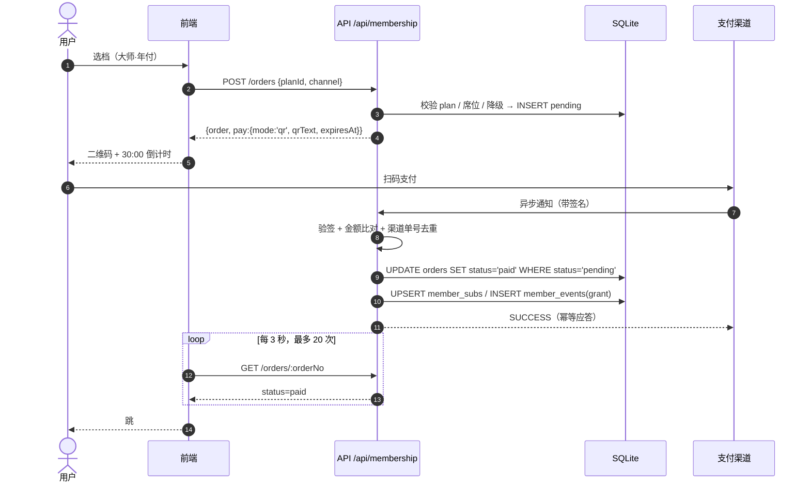
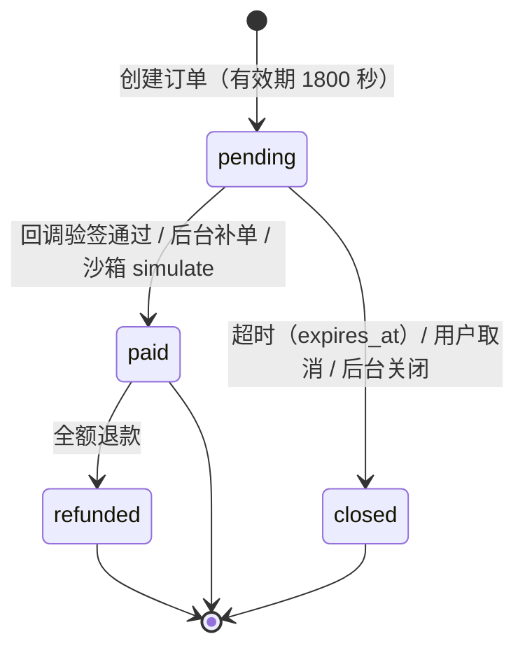

# 鲸域会员赞助系统设计

> 版本：v1 · 2026-10-23
> 读者：站点维护者本人（单人运维，2 核 4G 单机 + SQLite）
> 事实来源：`docs/membership-contract.md`（接口 / 定价 / 表结构 / 文件归属）。本文只补契约没写的部分——流程、取舍、运维动作、验收命令。
> 状态标记：✅ 现有代码已具备 ｜ 🟡 契约已定、代码待写 ｜ ⚪ 荣誉性承诺（人工交付） ｜ 🔵 后续扩展

---

## 1. 一页纸摘要

### 1.1 为什么做

站点目前纯自费：一台腾讯云轻量 + 对象存储 + 域名，按月支出 **68000 分（680.00 元）**。这笔钱没有收入侧，扩容、备份、短信通道都卡在「要不要自己掏」。会员赞助解决的不是变现，是**把一台机器的基础成本分摊给愿意分摊的人**，同时给赞助者一个可识别的身份。

### 1.2 目标

| 指标 | 目标值 | 口径 |
| --- | --- | --- |
| 月度净收入 | ≥ 68000 分（680.00 元） | 自然月 paid 金额 − 当月退款 − 渠道费 |
| 保本结构 | 36 位钻石 / 12 位大师 / 5 位宗师 / 2 位猎杀（任一条即可） | 月付价 × 人数 |
| 年付占比 | ≥ 40% | 年付单数 / 总单数（现金流前置） |
| 退款率 | ≤ 3% | refunded 单 / paid 单 |
| 赞助者墙 | ≥ 20 个署名 | show_name=1 的 active 订阅 |

按契约示例数据（本月 41200 分 = 412.00 元，完成 61%），距保本差 **26800 分（268.00 元）**——等于再拉 15 位钻石或 5 位大师。这是唯一需要天天看的经营指标。

### 1.3 不做什么（写死，避免以后自己加戏）

| 不做 | 理由 |
| --- | --- |
| 充值型虚拟币 / 站内余额 / 可转让点数 | 一旦「充进去能花」，就构成预付卡与资金池，涉及支付牌照与备付金；单人运维没有能力做资金存管 |
| 付费置顶、付费排序、付费删帖豁免 | 内容排序与 moderation 一旦能被钱影响，社区信任直接归零；契约只允许 `boost`（帖子加精**申请**），最终由管理员按内容质量决定 |
| 付费解锁站内已有内容 | 现有 28 个插件条目、帖子、榜单全部公开；会员权益只能是「增量服务 + 身份」 |
| 自动续费（首版） | 需要签约代扣协议与商户资质，首版用「到期前 7 天站内提醒 + 手动续费」 |
| 独立子域 / 独立应用 | 见 2.3 |

---

## 2. 现状与结合点

### 2.1 现有页面结构（与会员相关的部分）

| 路由 | 渲染函数（js/app.js） | 入口 | 与会员的关系 |
| --- | --- | --- | --- |
| `#/feed` | `feedPage()` :2262 | 顶栏第 1 项、移动端 tabbar | 右栏挂「服务器账单卡」 |
| `#/space/:uid` | `spacePage()` :4121 / `spaceSide()` :4293 | 顶栏「我的空间」、头像菜单 | 身份卡加档位徽章 |
| `#/thread/:id` | `threadPage()` :3954 | 社群列表、搜索 | 回复框下方加赞助条 |
| `#/rank` | `rankPage()` :5380 → `window.AIRank.html()` | 顶栏「AI排行」 | 独立模块范式参考（见 9.3） |
| `#/tags` | `tagsPage()` | 左栏「全部标签」 | 同上 |
| `#/messages` `#/dm` | `messagesPage()` / `dmPage()` | 顶栏铃铛、头像菜单 | 到账通知落这里 |
| `#/settings` `#/profile` | `settingsPage()` / `profilePage()` | 头像菜单 | 会员中心「账号」区可复用其样式 |
| `#/login` `#/verify` | `loginPage()` / `verifyPage()` | 顶栏离线胶囊、闸门 | 下单前的登录闸门 |
| `#/vip`（新） | `window.Member.html()` | 6 处入口 | 落地页，公开 |
| `#/vip/center`（新） | 同上 | 头像菜单 / 身份卡 | 会员中心，需登录 |
| `#/vip/pay/<orderNo>`（新） | 同上 | 下单后跳转 | 收银台，需登录 |
| `#/admin/sponsors`（新） | `window.MemberAdmin.html()` | 页脚（仅 admin 可见） | 后台，需 admin |

内部状态用 `S.route='vip'` + `S.vipView='landing'|'center'|'pay'` + `S.vipOrder`，与 `entry/plugin` 的 pid 深链同一套做法；`hashOf()` :5429 与 `applyHash()` :5456 各加一段。**不要**为三个 URL 造三个 `S.route`——`pageHTML()` :5388 的 if 链会变长，闸门文案也要写三份。

### 2.2 六个入口（位置、文案、跳转）

| # | 位置 | 代码落点 | 文案 | 跳转 |
| --- | --- | --- | --- | --- |
| 1 | 顶栏主导航 | `navHTML()` :633 的 `links` 数组加一项 | 「会员」 | `#/vip` |
| 2 | 头像菜单 | `mePop()` :760 菜单数组，插在「我的收藏」前 | 「会员中心」+ 右侧小字（`大师` / `未开通`） | `#/vip/center` |
| 3 | 个人空间身份卡 | `spaceSide()` :4293 的「个人资料」卡末行；自己空间加「续费」 | 「大师会员 · 2026-12-05 到期」/「还不是会员」 | `#/vip/center` |
| 4 | 首页右栏账单卡 | `feedSide()` :2398 新增 `costCard()` | 「本月 412 / 680 元 · 还差 268 元」，按钮「去支持」 | `#/vip` |
| 5 | 帖子 / 日志尾部 | `threadPage()` :3953 回复框后一行；日志卡片 footer | 「这台机器靠 37 个人养着 · 去支持」 | `#/vip` |
| 6 | 页脚 | `FOOTER` :5413 加一条 `<a data-act="go" data-route="vip">` | 「赞助与会员」 | `#/vip` |

取舍：

- 顶栏加第 7 项会让 `nav-links` 在 1180px 左右开始挤，所以 **≤760px 隐藏这一项**（移动端走头像菜单，tabbar 五项已满，不动）。
- 入口 4 只在首屏与社群列表页挂，帖子详情、插件库不挂——账单卡是「催缴」，不是「内容」。
- 入口 5 用一行 13px 细条，不占卡片；`threadPage` 已有 3 张右栏卡，再塞一张会顶掉「相关话题」。
- 入口 3 是唯一展示到期日的地方——个人空间的曝光高于会员中心。

### 2.3 为什么不新开子域

| 理由 | 具体后果 |
| --- | --- |
| Cookie 同源 | 登录态是 httpOnly Cookie（`server/src/auth.js:20` 的 `jingyu_token`），fetch 用 `credentials:'same-origin'`（`js/api.js:36`）。跨子域要改 SameSite=None + Secure + CORS + 每处 fetch 改 `include`，README:39-41 已记过一次「登录返回 200、刷新变游客」 |
| CSP 白名单 | 线上 nginx 用内联脚本 sha256 白名单（README:733）。新域要重算哈希、重签证书 |
| 备案与支付 | 支付渠道要求回调域名与经营主体一致；子域要单独备案与证书，多一份年检负担 |
| 单机资源 | 一台 2 核 4G 同时跑 nginx + node + SQLite，再加站点没有收益 |
| 信任 | 用户在 `jingyu` 域上已登录、发过帖，同域收款页可信度明显高于陌生子域 |

结论：**同域 hash 路由**，成本为 0，唯一代价是首屏多一个模块（`js/membership.js` 约 40 KB 未压缩）。

---

## 3. 会员体系

### 3.1 五档定位与命名

| tier | 名称 | 定位 | 命名理由 |
| --- | --- | --- | --- |
| `free` | 旅人 | 未赞助的普通用户 | 「旅人」不是「游客」：站内内容全部可读，只是不带身份。避免把没付钱的人叫成「白嫖」 |
| `diamond` | 钻石 | 入门档，覆盖「一杯奶茶」心理价位 | 硬度阶梯第一级，与 AI 榜单里的 Diamond 档同词，社区已有认知 |
| `master` | 大师 | 主力档，目标人数最多 | 棋类 / 模型能力分级的通用词，比「黄金」少一点土味 |
| `grandmaster` | 宗师 | 高客单，买的是咨询与私有仓库 | 大师之上的唯一一级，中文语义明确，不用再造词 |
| `hunt` | 猎杀 | 20 席限量，最高档 | 「猎杀」是站内梗（猎杀名单 / 猎杀时刻），绯红配色，天然带稀缺感；不叫「终身」「至尊」，避免承诺不该承诺的东西 |

### 3.2 价格锚点

| 档 | 月付 | 年付 | 年付原价 | 年付等效月价 | 实省 | 折扣 |
| --- | --- | --- | --- | --- | --- | --- |
| 钻石 | 1900 分（19.00 元） | 18800 分（188.00 元） | 22800 分（228.00 元） | 1566.67 分（15.67 元） | 4000 分（40.00 元）≈ 2.1 个月 | 17.5% |
| 大师 | 5800 分（58.00 元） | 56800 分（568.00 元） | 69600 分（696.00 元） | 4733.33 分（47.33 元） | 12800 分（128.00 元）≈ 2.2 个月 | 18.4% |
| 宗师 | 13800 分（138.00 元） | 128800 分（1288.00 元） | 165600 分（1656.00 元） | 10733.33 分（107.33 元） | 36800 分（368.00 元）≈ 2.7 个月 | 22.2% |
| 猎杀 | 38800 分（388.00 元） | 368800 分（3688.00 元） | 465600 分（4656.00 元） | 30733.33 分（307.33 元） | 96800 分（968.00 元）≈ 2.5 个月 | 20.8% |

锚点设计：

- **月付 19 / 58 / 138 / 388**，四档之间约 3×、2.4×、2.8×，不是等比——目的是让「大师」在中间显得最划算（58 元 ≈ 两杯咖啡），把选择推向主力档。
- **年付不是「省 2 个月」而是「省 17%–22%」**：按契约价格实际省 2.1–2.7 个月（见上表），前端文案统一写「年付约 8 折」，**不要写「省 2 个月」**，否则宗师档用户自己一算就对不上（契约数值不一致，见附录 A-2）。
- **年付是现金流工具**：一位大师年付 56800 分一次到账 ≈ 9.8 个月的月付现金，可摊平「没凑够」的月份。
- 价格全部存 `member_plans`，后台可改；改价**只影响新订单**，已付订单金额不回溯。

### 3.3 权益矩阵（含实现方式 / 状态）

| key | 权益 | 旅人 | 钻石 | 大师 | 宗师 | 猎杀 | 怎么实现 | 状态 |
| --- | --- | --- | --- | --- | --- | --- | --- | --- |
| `badge` | 赞助者徽章与专属配色 | — | ✓ | ✓ | ✓ | ✓ | `member_subs.tier` → 前端 `av()` / 昵称旁渲染档位 class，配色用契约强调色 | 🟡 |
| `wall` | 赞助者墙署名（可匿名） | — | ✓ | ✓ | ✓ | ✓ | `GET /api/membership/wall` + 落地页墙；`show_name=0` 显示「匿名鲸友」 | 🟡 |
| `status` | 服务器状态页与故障预告 | — | ✓ | ✓ | ✓ | ✓ | 落地页一块静态「运行状态」，维护者手改（或外链 Uptime Kuma） | ⚪ |
| `download` | 高清原图 / 插件包下载额度 | 10/日 | 50/日 | 200/日 | 不限 | 不限 | 需下载计数表（现无），首版只做文案 + 人工核查 | 🔵 |
| `emoji` | 专属表情与贴纸包 | — | ✓ | ✓ | ✓ | ✓ | 复用现有回复表情面板，按档位追加一组；数据放独立模块 | 🟡 |
| `boost` | 帖子加精 / 首页推荐申请 | — | — | ✓ | ✓ | ✓ | 申请表 + 管理员手工置 `threads.hot/top`（`schema.sql:148-149` 已有字段） | ⚪ |
| `private` | 私有插件仓库托管 | — | — | — | 3 个 | 10 个 | 人工在服务器开 Git 仓库 + 只读 token，无自助界面 | ⚪ |
| `beta` | 新功能内测通道 | — | — | — | ✓ | ✓ | 人工发内测 key / 拉群 | ⚪ |
| `consult` | 1v1 技术咨询 | — | — | — | 1 次/月 | 4 次/月 | 人工排期（邮件或私信），无预约系统 | ⚪ |
| `title` | 自定义称号后缀 | — | — | — | — | ✓ | `users` 表无此字段，需新增列或独立表 | 🔵 |
| `thanks` | 年度感谢名单 / 服务器铭牌 | — | — | — | ✓ | ✓ | 年底手工整理，写进年度日志 | ⚪ |
| `priority` | 工单优先响应 | — | — | — | — | ✓ | 站点无工单系统，落地为「私信 / 邮件 24h 内回」 | ⚪ |

**必须说清的边界**：12 项里真正由代码自动交付的只有 `badge`、`wall` 两项；`download`、`title`、`priority` 依赖不存在的系统；其余 7 项是**人工承诺**。所以落地页权益表必须带小字说明交付方式（「自动」「人工，48h 内」「按年」），否则第一笔退款就会以「权益没兑现」为由。

### 3.4 猎杀 20 席

- 席位存 `member_plans.seats`（`hunt` = 20，其余 0 = 不限）。
- 剩余 = `20 − COUNT(member_subs WHERE tier='hunt' AND expires_at > now)`。**必须用 `expires_at > now` 而不是 `tier != 'free'`**：契约的到期是惰性清理（用户不访问就不改 tier），用 tier 判断会把已过期但没被访问的人算成占席（附录 A-4）。
- 防超卖：创建订单与授予都在 `BEGIN IMMEDIATE` 事务里先 `COUNT` 再写；`better-sqlite3` 是同步 API，单进程内不会交错，但后台补单与用户下单是两个请求，事务边界仍然必要。
- 满席时 `POST /orders` 回 409 `SEATS_FULL`，前端把猎杀卡置灰并显示「20 / 20 已满，等有人到期」，同时推荐宗师档——**不做排队 / 候补**，没精力维护队列。

### 3.5 升级 / 续费 / 到期 / 降级

统一符号：`P_old` = 当前订阅对应 plan 的 `price_cents`，`D_old` = 其 `duration_days`，日单价 `u_old = P_old / D_old`；新档同理 `u_new`。

| 场景 | 规则 | 例子（全部按分计算） |
| --- | --- | --- |
| 同档续费 | `newExpires = max(now, oldExpires) + durationDays` | 大师月付剩 12 天，再买 30 天 → 到期 = now + 42 天 |
| 升级 | `credit = floor(剩余天数 × u_old)`；`extraDays = floor(credit / u_new)`；`newExpires = now + durationDays + extraDays` | 大师月付（u=193.33）剩 12 天 → credit = 2320 分；钻石月付 u=63.33 → extraDays = 36；新到期 = now + 30 + 36 = 66 天 |
| 升级（年付→月付） | 日单价取**当前 plan 自己的** `price/duration`，不按 30 天折算 | 钻石年付（u=18800/365=51.51）剩 100 天 → credit = 5151 分；大师月付 u=193.33 → extraDays = 26 → now + 56 天 |
| 降级 | 拒绝，409 `DOWNGRADE_NOT_ALLOWED`，文案「高等级到期后自然回落，不支持主动降级」 | 宗师 → 大师：不写库，直接报错 |
| 到期 | 不做定时任务；读 `/me`、`/orders`、`/overview` 时若 `expires_at <= now` 视为 free，并顺手把 `member_subs.tier` 改成 `free` | 到期当天用户访问，身份卡变「旅人 · 已到期 3 天」 |
| 折算上限 | `extraDays` 上限 365，防脏数据算出几年 | credit 异常（如剩 3000 天）时截断并记 `member_events.note` |

**为什么升级给「更多天数」而不是「补差价换档」**：补差价要按剩余价值比例退钱，单人运维对不上账；折成天数只动一个 `expires_at`，零资金流转，也堵住「降级套利」。

---

## 4. 赞助入口与支付流程

### 4.1 用户旅程（8 步）

1. 在帖子尾部或右栏账单卡看到「还差 268 元」→ 点进 `#/vip`。
2. 落地页看到四档价格、剩余席位、赞助者墙 → 选「大师 · 年付」。
3. 未登录 → 闸门送 `#/login`，登录后回跳（用 `S.authNext` 记原路由）。
4. 点「支持」→ `POST /api/membership/orders` → 返回 `{order, pay}`。
5. 跳 `#/vip/pay/JY20261023AB12CD`：二维码 + 30:00 倒计时 + 「我已完成支付」。
6. 扫码付款；渠道异步回调 → 服务端验签、比对金额、置 paid、授予订阅。
7. 前端每 3 秒轮询 `GET /orders/:no`，最多 20 次（60 秒）；paid 后跳会员中心。
8. 身份卡变「大师 · 还剩 365 天」，头像菜单显示「大师」，赞助者墙出现（或匿名）。

### 4.2 时序图



### 4.3 渠道对比

| 渠道 | 资质 | 费率 | 到账 | 对接成本 | 取舍 |
| --- | --- | --- | --- | --- | --- |
| 微信 Native | 企业/个体户营业执照 + 微信商户号 | 0.6% | T+1 | 中（预下单 + 二维码 + 回调验签） | 首选，扫码体验最好；个人身份开不了 |
| 支付宝当面付 | 营业执照（个体户可） | 0.6% | T+1 | 中（`precreate` 拿 `qr_code`） | 微信的备份，覆盖不用微信的人 |
| 人工转账 | 无 | 0 | 即时 | 低（个人收款码 + 后台补单） | **首版主力**：零资质、当天能用；代价是每单人工核对 |
| 爱发电 | 无（平台代收） | 平台抽成约 5% | 平台结算 | 低（跳外链） | 备用；数据在第三方，会员要手工同步 |

首版策略：**人工转账 + 沙箱**跑通全链路，同时提交商户资料；商户号下来后只切配置，不改代码。

### 4.4 沙箱与真实渠道切换

| 状态 | 判定 | 表现 |
| --- | --- | --- |
| 沙箱 | `member_settings.sandbox=1` 或 `NODE_ENV!=='production'` | 创建订单回 `pay.mode='demo'`；收银台显示「演示占位（沙箱）」；`POST /orders/:no/simulate` 一键置 paid |
| 未配密钥 | 生产 + `sandbox=0` 但缺 `WXPAY_MCHID` 等 | 回 `pay.mode='demo'`，前端明确写「渠道未接通，请联系维护者人工转账」 |
| 真实 | 生产 + `sandbox=0` + 密钥齐全 | 回 `pay.mode='qr'`（微信/支付宝）或 `redirect` |

切换步骤（按顺序，任一步失败就停）：

1. 沙箱全流程跑通（验收清单 7–17 条）。
2. 商户号下来后，在 `server/.env` 增：微信 `WXPAY_MCHID / WXPAY_APPID / WXPAY_KEY / WXPAY_CERT_SERIAL / WXPAY_NOTIFY_URL`，支付宝 `ALIPAY_APPID / ALIPAY_PRIVATE_KEY / ALIPAY_PUBLIC_KEY / ALIPAY_NOTIFY_URL`（**契约与 `.env.example` 都没有这些键，需补，见附录 A-1**）。
3. `chmod 600 .env`，重启后端服务。
4. `sqlite3 data/jingyu.db "UPDATE member_settings SET value='0' WHERE key='sandbox'"`。
5. 真实账号下 1900 分（19.00 元）钻石月付，付 1 笔，确认：订单 paid、订阅 +30 天、`member_events` 有一条 `grant`、后台 KPI +19。
6. 立刻后台退款，确认 `refunded` + 订阅回滚。
7. `journalctl -u jingyu-api -f` 看回调日志，拿错签名请求试一次，确认被拒。

### 4.5 订单状态机



### 4.6 幂等 / 超时 / 对账 / 退款

| 机制 | 做法 |
| --- | --- |
| 幂等（授予） | `UPDATE member_orders SET status='paid', paid_at=? WHERE order_no=? AND status='pending'`，只有 `changes === 1` 才执行授予；重复回调直接回当前订单，**不再加天数** |
| 幂等（渠道单号） | `provider_txn` 加唯一索引（部分索引 `WHERE provider_txn IS NOT NULL`），同一笔渠道流水第二次进来直接命中已有订单 |
| 订单号 | `JY + yyyymmdd + 6 位大写 hex`（如 `JY20261023AB12CD`）；`order_no` 唯一索引，撞车重抽 3 次 |
| 超时关单 | 不做 cron：`GET /orders`、`GET /overview`、`simulate` 前先跑 `UPDATE ... SET status='closed', closed_at=? WHERE status='pending' AND expires_at<=now`（惰性关单）；每日对账脚本再兜一次 |
| 静默 30 分钟 | `expires_at = created_at + 1800`；倒计时归零后禁用「我已完成支付」，只留「重新下单」 |
| 对账 | 每日 02:10 跑 `node server/scripts/reconcile-membership.js --day=yesterday`：拉渠道账单 → 与本地 paid 订单按 `provider_txn` 比对 → 输出三类差异（渠道有本地无 / 本地有渠道无 / 金额不符）到 `server/data/reconcile-YYYYMMDD.log`，不自动改库，人工确认后走补单 |
| 退款 | 只支持全额；`refund_cents = amount_cents`；退款后若 `member_subs.order_no` 等于该订单则 `expires_at -= 授予天数`，`<= now` 直接删行回 free；不等则只退款不动订阅，`note` 写清原因 |
| 退款窗口 | 7 天内且**未使用任何付费权益**（无 boost 申请、无 consult 排期、无 private 仓库）可全额退；超过 7 天或已使用，退剩余整月（按 `未用天数 × u_old` 折算，最低 0） |

### 4.7 失败与掉单兜底

| 现象 | 处理 |
| --- | --- |
| 回调丢失（网络/验签失败/服务重启） | 用户点「我已完成支付」→ 前端 `GET /orders/:no`；仍 pending 则提示「支付结果还没回来，最多等 5 分钟，超时请联系维护者并提供订单号」 |
| 用户付了但订单 closed | 后台「按订单号补单」：`mark-paid`，`note` 必填「渠道流水号 + 用户截图时间」 |
| 用户重复付款（两个 pending 订单） | 对账发现同一 `provider_txn` 对应两张单 → 保留先到的一张，另一张退款；**根因是契约的 5 分钟复用窗口 < 30 分钟支付窗口，见附录 A-3** |
| 回调金额不符 | 拒绝授予，订单保持 pending，`note` 记「金额不符：期望 X 实收 Y」，后台标红 |
| 渠道长时间不可用 | 落地页顶部挂黄条「在线支付暂不可用，可人工转账」，渠道表只回 `manual` |
| 服务重启丢内存态 | 全部状态在库，重启后轮询照常；`provider_txn` 唯一索引保证不会重复授予 |

---

## 5. 账号与个人中心

### 5.1 为什么复用现有 AUTH

| 现有能力 | 代码 | 复用理由 |
| --- | --- | --- |
| httpOnly Cookie 会话 + `sessions` 表回表校验 | `server/src/auth.js:20,35-51` | 会员是「钱 + 身份」，不能另起一套弱鉴权；删行即失效，比自包含 JWT 可控 |
| 每类设备一条会话（v46 前是「单账号单会话」） | `auth.js` 的 `createSession` + `(user_id, device)` 索引 | 同一台设备只有一处登录（手机 + 电脑各一条），减少「账号共享卖会员」的动机 |
| 登录失败锁定（按邮箱指数退避） | `auth.js` + `lockout.js`，`routes/auth.js:146-152` | 会员账号更容易被撞库，现成锁定直接生效 |
| 邮箱归一化（大小写 / `+` 别名 / 尾点） | `routes/auth.js:60-69` | 防同一人用 `a+1@x.com` 注册小号刷新人价 |
| 注册即登录 | `routes/auth.js:116-124` | 收银台不必再处理「注册完还要登录一次」的断点 |
| 手机号闸门 | `app.js:5637-5641` + `js/api.js:24` `phoneEnabled()` | 短信通道没接通时闸门自动放行；接上后自动收紧，前端不用改 |

**现状必须写清**：`/api/auth/phone/config` 的 `smsEnabled` 默认 `false`（`js/api.js:24`），所以手机号**目前不是硬闸门**。会员系统不新增手机号要求。

### 5.2 会员中心信息架构

| 区块 | 内容 | 数据来源 | 空态 |
| --- | --- | --- | --- |
| 身份卡 | 档位名、配色、昵称、剩余天数、到期日、进度条 | `GET /me` 的 `member` | 「旅人 · 还没开通」+「看看方案」 |
| 倒计时 | 「还剩 42 天」；≤7 天变琥珀色并加「该续费了」 | `daysLeft` | 不显示 |
| 权益清单 | 12 项逐条，已解锁打勾，未解锁灰显并写「宗师起」 | `benefitKeys` + 契约 1.1 | 全灰 + 「开通任一档即解锁前 6 项」 |
| 订单列表 | 订单号、档位、金额、状态、时间、操作（支付/关闭/详情） | `GET /orders` | 「还没有订单记录」+「去选一个档」 |
| 发票 / 收据 | 按钮 → 生成 `mailto:` 草稿（主题含订单号），人工回电子收据 | 本地拼装 | 「暂不需要」 |
| 匿名开关 | 「在赞助者墙显示我的昵称」 | `POST /me/visibility` | 默认开 |

### 5.3 订单查询

- **登录态列表**：`GET /api/membership/orders?status=all&limit=20&offset=0`，分页用「加载更多」，不做无限滚动（订单不该无限刷）。
- **订单号直查**：`GET /api/membership/orders/:orderNo`，本人或 admin；用于「我付了但页面没变」时把订单号贴进会员中心顶部的小输入框。
- **越权**：他人订单返回 404（不是 403）——403 会泄露「这个订单号存在」。

### 5.4 空态与异常态文案

| 场景 | 文案 |
| --- | --- |
| 未登录进会员中心 | 「登录后才有你的会员信息」+「去登录」 |
| 从未下过单 | 「还没有订单。四档里最便宜的一档是 19 元，等于一杯奶茶。」 |
| 订单列表为空但筛了「已退款」 | 「没有退款记录，这是好事。」 |
| 订单已关闭 | 「这笔订单超时关闭了（30 分钟内未支付）。要的话重新下一单，价格以当时为准。」 |
| 网络失败 | 「订单没加载出来，检查网络后重试。」+「重试」按钮 |
| 渠道未接通 | 「在线支付还没接通，可以先人工转账，备注订单号。」 |
| 沙箱 | 「当前是演示环境，点这里模拟支付成功」 |

---

## 6. 后台管理

### 6.1 权限模型：现状与风险

现状：`isAdmin(user) = user.level >= 15 || user.badge === '版主'`（`server/src/auth.js:375-377`），全站只有一处使用（`routes/posts.js:166` 删他人帖子）。没有角色表、没有审计、没有二次验证。

风险（按严重度）：

1. **演示账号就是管理员**：`server/scripts/seed.js:20` 把「豆腐」设为 `level: 15, badge: '版主'`，即 `demo3@jingyu.local / jingyu1234` 天生是 admin。生产若照跑 seed，任何看过 README 的人都能进后台补单、退款。
2. `level` 与 `badge` 没有独立的变更审计，改库即提权。
3. 同设备顶号意味着**顶号即接管**（v46 起只顶同类设备那一台），后台没有二次确认。
4. 无法表达「只读财务」「只能看订单不能退款」这类分级。

首版对策（不引入新框架）：

- 生产改掉演示账号密码，或不跑 seed 的用户部分；后台另加 `ADMIN_EMAILS` 白名单，只允许维护者本人邮箱。
- 后台**所有写操作**（补单、退款、关单、改价）要求 `note` 必填 ≥ 10 字，并写 `member_events.actor = 'admin:<id>'`。
- 退款与改价加二次确认弹层（输入订单号后 6 位），防误点。
- 后续扩展：`member_admin_roles(user_id, role)` 三档（owner / finance / support）。

### 6.2 四个区块

| 区块 | 路由 | 内容 | 主要动作 |
| --- | --- | --- | --- |
| 概览 | `#/admin/sponsors`（默认） | 6 个 KPI + 30 天柱状 + 档位分布 + 渠道分布 + 7 天内到期名单 + 待付订单 | 刷新、导出 |
| 订单 | 同上，页签 | 筛选（状态/档位/渠道/关键词/日期）+ 表格 + 合计 | 补单、退款、关闭、复制订单号 |
| 价格 | 同上，页签 | 8 条 plan 的 `price/list/duration/seats/active/sort` | 改价、上下架、改席位 |
| 报表 | 同上，页签 | 90 天 CSV 导出 + 月度汇总 | 下载 CSV |

非管理员进 `#/admin/sponsors`：显示 403 卡片「这里只有管理员能进」+「返回首页」，不白屏、不弹 toast。

### 6.3 KPI 定义与公式

区间默认近 30 天（`?days=30`），「本月」一律指自然月（Asia/Shanghai）。

| KPI | 公式 | 注意 |
| --- | --- | --- |
| `gmvCents` | Σ `amount_cents`（`status IN ('paid','refunded')` 且 `paid_at` 在区间） | 含后来退款的单，反映「收过多少钱」 |
| `refundCents` | Σ `refund_cents`（`status='refunded'` 且 `refunded_at` 在区间） | **按退款发生月归属**，不追溯原单月份 |
| `netCents` | `gmvCents − refundCents` | 不含渠道费（0.6% 另记） |
| `orders` | `COUNT(*)`（paid + refunded，区间内） | 不含 pending/closed |
| `payingUsers` | `COUNT(DISTINCT user_id)` 同上口径 | 一人多单算一人 |
| `newMembers` | 区间内 `member_events` 中 `grant`/`manual` 事件的去重用户数 | 续费=renew、升级=upgrade，不算新会员；`started_at` 会被续写，不能当依据 |
| `renewRate` | 区间内 `renew` 事件数 /（`renew` 事件数 + 区间内到期订阅数），上限 100% | 分母不用「到期订阅数」单独做，避免同一订阅多次续费把比值顶过 100% |
| `arppuCents` | `netCents / payingUsers` | 分母为 0 时回 0，不除零 |
| `monthNetCents` | 本月 `gmv − refund` | 唯一与 68000 对比的数字 |
| `goalPercent` | `min(100, round(monthNetCents / goalCents * 100))` | 封顶 100，超额另给 `over` 布尔 |
| `pending` | `COUNT(*)`（`status='pending' AND expires_at > now`） | 过期单由下单流程惰性关闭，后台不把过期单算作待处理 |

口径边界：**`channel='manual'` 且 `amount_cents=0` 的赠送单不计入 `gmv/net/arppu`**，只单列「赠送 N 次」，否则 ARPPU 会被稀释（附录 A-8）。

### 6.4 CSV 字段

`GET /api/admin/membership/report.csv?days=90`，`text/csv; charset=utf-8` + BOM，文件名 `membership-report-YYYYMMDD.csv`。

| # | 列 | 来源 | 说明 |
| --- | --- | --- | --- |
| 1 | 订单号 | `order_no` | 唯一，可直查 |
| 2 | 创建时间 | `created_at` | `2026-10-23 16:54:30` |
| 3 | 支付时间 | `paid_at` | 未付为空 |
| 4 | 用户 | `users.name` | 昵称 |
| 5 | 邮箱 | `users.email` | 完整（仅后台导出） |
| 6 | 等级 | `tier` | 英文 key，便于透视 |
| 7 | 周期 | `cycle` | month / year |
| 8 | 金额(元) | `amount_cents/100` | 两位小数 |
| 9 | 渠道 | `channel` | wechat / alipay / manual |
| 10 | 状态 | `status` | 英文 key |
| 11 | 退款(元) | `refund_cents/100` | 两位小数 |
| 12 | 备注 | `note` | 补单/退款原因 |

Excel 打开中文不乱码的关键是 BOM（`\uFEFF`）——契约已写，落地时别忘。

### 6.5 手动补单与退款的操作规范

| 动作 | 谁 | 何时 | 留痕 |
| --- | --- | --- | --- |
| 补单 `mark-paid` | 维护者本人（`ADMIN_EMAILS` 命中） | 用户提供「订单号 + 渠道流水号 + 付款截图时间」，且对账确认钱到了 | `admin_id`、`note`（流水号 + 截图时间，≥10 字）、`member_events(kind='manual', actor='admin:<id>')` |
| 退款 `refund` | 同上 | 7 天内且未使用权益；或重复付款；或渠道强制退款 | `refunded_at`、`refund_cents`、`note`（原因 + 渠道退款单号） |
| 关单 `close` | 同上 | 用户明确不付；或订单明显异常 | `closed_at`、`note` |
| 改价 `PUT /plans/:id` | 同上 | 成本变化、促销；**一次只改一档**，改完在站务发公告 | `member_events(kind='plan_change')` |

红线：不在聊天记录里承诺「私下转账给你打折」；所有钱只走渠道或对公；补单只补「钱已到账」的单。

### 6.6 审计事件表

复用 `member_events`（契约 §3），不新增表：

| kind | 触发 | actor | 关键字段 |
| --- | --- | --- | --- |
| `grant` | 首次支付成功 / 沙箱 simulate | system / user | tier, days, amount_cents, order_no |
| `renew` | 同档续费 | system | days, amount_cents |
| `upgrade` | 跨档升级 | system | tier, days（含折算 extraDays）, amount_cents |
| `refund` | 后台退款 | admin:<id> | amount_cents, note |
| `manual` | 后台补单 / 赠送 | admin:<id> | tier, days, note |
| `plan_change` | 改价 / 改席位 / 上下架 | admin:<id> | note 写「price 1900→2100」 |
| `close` | 关单 | user / admin:<id> | order_no, note |

---

## 7. 数据模型

### 7.1 五张表

**member_plans**（价格与席位，后台可改）

| 字段 | 类型 | 含义 | 约束 |
| --- | --- | --- | --- |
| id | INTEGER PK | 自增 | |
| tier | TEXT | diamond/master/grandmaster/hunt | `UNIQUE(tier, cycle)` |
| cycle | TEXT | month / year | 同上 |
| price_cents | INTEGER | 实售价（分） | > 0 |
| list_cents | INTEGER | 划线原价（分） | 0 = 不显示折扣 |
| duration_days | INTEGER | 30 / 365 | 与 cycle 对应 |
| seats | INTEGER | 0 = 不限 | hunt = 20 |
| active | INTEGER | 1 上架 / 0 下架 | 下架不影响已购 |
| sort | INTEGER | 展示顺序 | 钻石→猎杀 |
| perks | TEXT | JSON 数组，额外卖点 | 默认 `[]` |
| created_at / updated_at | INTEGER | Unix 秒 | 改价必须更新 |

**member_orders**（订单，财务凭证）

| 字段 | 类型 | 含义 | 约束 |
| --- | --- | --- | --- |
| id | INTEGER PK | | |
| order_no | TEXT | `JY20261023AB12CD` | UNIQUE |
| user_id | INTEGER | 下单人 | 索引 |
| plan_id | INTEGER | 下单时价格快照指向 | 可空（plan 被删） |
| tier / cycle | TEXT | **冗余快照**，改价不影响历史 | |
| amount_cents | INTEGER | 实付（分） | ≥ 0（赠送 0） |
| status | TEXT | pending/paid/closed/refunded | 索引 |
| channel | TEXT | wechat/alipay/manual | |
| provider_txn | TEXT | 渠道流水号 | 部分唯一索引 |
| created_at / paid_at / expires_at / closed_at / refunded_at | INTEGER | Unix 秒 | `expires_at = created_at + 1800` |
| refund_cents | INTEGER | 已退（分） | 默认 0 |
| note | TEXT | 补单/退款原因 | 后台写操作必填 |
| admin_id | INTEGER | 操作人 | 手动单才有 |
| client_ip / ua | TEXT | 风控与取证 | 180 天后清空 |

**member_subs**（当前订阅，一人一行）

| 字段 | 类型 | 含义 | 约束 |
| --- | --- | --- | --- |
| user_id | INTEGER PK | 一人一条 | 无外键（附录 A-6） |
| tier | TEXT | 当前档位，到期可惰性改 free | 索引 `(tier, expires_at)` |
| started_at / expires_at | INTEGER | Unix 秒 | `expires_at` 是唯一真相 |
| order_no | TEXT | 最近一次授予来源 | 退款回滚用 |
| auto_renew | INTEGER | 首版恒 0 | 预留 |
| show_name | INTEGER | 1 上墙 / 0 匿名 | 默认 1 |
| note | TEXT | 人工备注 | |
| updated_at | INTEGER | | |

**member_events**（审计流水，只追加）

| 字段 | 类型 | 含义 |
| --- | --- | --- |
| id | INTEGER PK | |
| user_id | INTEGER | 对象用户（plan_change 时为操作人） |
| order_no | TEXT | 关联订单，可空 |
| kind | TEXT | grant/renew/upgrade/refund/manual/plan_change/close |
| tier / days / amount_cents | | 快照 |
| actor | TEXT | system / admin:<id> / user |
| note | TEXT | 人读原因 |
| created_at | INTEGER | 索引 |

**member_settings**（键值）

| key | 初始值 | 含义 |
| --- | --- | --- |
| `monthly_goal_cents` | 68000 | 月度目标（680.00 元） |
| `sandbox` | **建议 0** | 1 = 允许 simulate（契约初始值 1，高风险，附录 A-5） |
| `wall_enabled` | 1 | 赞助者墙总开关 |

### 7.2 关系

- `member_orders.user_id → users.id`、`member_subs.user_id → users.id`：1:1（订阅）与 1:N（订单）。契约没写外键，建议补 `REFERENCES users(id) ON DELETE CASCADE`，与 `schema.sql:9` 的通篇约定一致。
- `member_orders.plan_id → member_plans.id` 可空：plan 可下架甚至删除，订单必须留 `tier/cycle/amount_cents` 快照。
- `member_subs.order_no → member_orders.order_no`（逻辑关联，不建外键，避免删单卡住订阅）。
- `member_events` 是唯一事实流水：任何 `member_subs` 变化都必须能在这里找到一条对应事件，对不上就是 bug。

### 7.3 索引理由

| 索引 | 支撑的查询 | 不建会怎样 |
| --- | --- | --- |
| `member_orders(user_id, created_at)` | 会员中心订单列表（按人、按时间倒序） | 全表扫；3 年后 1 万单时明显变慢 |
| `member_orders(status, created_at)` | 后台按状态筛 + 待付统计 | 概览每次全表 |
| `member_orders(order_no)` | 直查 / 回调 / 补单 | 回调要全表，且无法做唯一约束 |
| `member_orders(provider_txn) WHERE provider_txn IS NOT NULL` | 回调去重 | 同一笔钱可能授两次 |
| `member_events(created_at)` | 审计页按时间翻 | 排序走临时表 |
| `member_subs(tier, expires_at)` | 猎杀席位统计、7 天内到期名单 | 每次算席位全表 |

### 7.4 数据保留

| 数据 | 期限 | 动作 |
| --- | --- | --- |
| `member_orders` | 永久 | 财务凭证，不删；只归档 |
| `member_events` | 3 年 | 每日脚本删 `created_at < now-3y` |
| `member_subs` | 跟随用户 | 用户删除时 CASCADE |
| `client_ip` / `ua` | 180 天 | 每日置空 |
| CSV 导出文件 | 7 天 | 落 `server/data/exports/`，定时清理 |
| 对账日志 | 90 天 | `reconcile-*.log` |

---

## 8. 接口清单

统一 `{ok:true,data}` / `{ok:false,error:{code,message}}`（`server/src/http.js:44`），时间一律 Unix 秒。

| 方法 | 路径 | 权限 | 入参 | 出参 | 错误码 |
| --- | --- | --- | --- | --- | --- |
| GET | `/api/membership/overview` | 公开 | — | tiers/plans/seats/stats/wall/channels/sandbox | — |
| GET | `/api/membership/wall` | 公开 | — | `{items:[{name,tier,since,note}]}` ≤60 | — |
| GET | `/api/membership/me` | 登录 | — | member/benefitKeys/pricing/totals | 401 `NOT_AUTHED` |
| GET | `/api/membership/orders` | 登录 | status, limit, offset | `{items,total}` | 401 |
| GET | `/api/membership/orders/:orderNo` | 本人或 admin | — | `{order}` | 401 / 404 `NOT_FOUND` |
| POST | `/api/membership/orders` | 登录 | `{planId, channel}` | `{order, pay}` | 400 `BAD_CHANNEL` / 404 `PLAN_NOT_FOUND` / 409 `PLAN_INACTIVE`·`SEATS_FULL`·`DOWNGRADE_NOT_ALLOWED` |
| POST | `/api/membership/orders/:orderNo/simulate` | 本人（沙箱） | — | `{order, member}` | 401 / 403 `SANDBOX_OFF`·`FORBIDDEN` / 404 |
| POST | `/api/membership/orders/:orderNo/close` | 本人或 admin | — | `{order}` | 401 / 404 / 409 `ORDER_NOT_PENDING` |
| POST | `/api/membership/me/visibility` | 登录 | `{show:boolean}` | `{showName:0\|1}` | 401 |
| GET | `/api/admin/membership/overview` | admin | days=30 | kpi/series/tiers/channels/expiring/plans | 403 `FORBIDDEN` |
| GET | `/api/admin/membership/orders` | admin | status,tier,channel,q,from,to,limit,offset | `{items,total,sumCents}` | 403 |
| POST | `/api/admin/membership/orders/:orderNo/mark-paid` | admin | `{note}` | `{order, member}` | 403 / 404 / 409 |
| POST | `/api/admin/membership/orders/:orderNo/refund` | admin | `{note}` | `{order, member}` | 403 / 404 / 409 `NOT_PAID` |
| POST | `/api/admin/membership/orders/:orderNo/close` | admin | `{note}` | `{order}` | 403 / 404 |
| GET | `/api/admin/membership/plans` | admin | — | `{plans}`（含 inactive） | 403 |
| PUT | `/api/admin/membership/plans/:id` | admin | 任意子集 priceCents/listCents/durationDays/seats/active/sort | `{plan}` | 403 / 404 / 400 |
| POST | `/api/admin/membership/grant` | admin | `{email?,userId?,tier,days,note?}` | `{order, member}` | 403 / 404 `USER_NOT_FOUND` |
| GET | `/api/admin/membership/members` | admin | q, limit | `{items}` | 403 |
| GET | `/api/admin/membership/report.csv` | admin | days=90 | CSV（BOM，12 列） | 403 |

**错误 message 需要补**：`http.js` 的 `MSG` 表（:11-38）里没有 `PLAN_NOT_FOUND / PLAN_INACTIVE / SEATS_FULL / DOWNGRADE_NOT_ALLOWED / BAD_CHANNEL / SANDBOX_OFF / FORBIDDEN` 七条，直接 `fail(reply,404,'PLAN_NOT_FOUND')` 会回「请求有误」。要么补表，要么每个调用点传第 5 个参数（附录 A-9）。

---

## 9. 实现步骤

### 9.1 六个阶段

| 阶段 | 改哪些文件 | 验收命令 | 工时 |
| --- | --- | --- | --- |
| P0 数据库与种子 | `server/src/schema-membership.sql`（新）、`server/src/db.js`（:52 后追加 exec + 建种子函数）、`server/scripts/seed-membership.js`（新） | `cd server && node -e "require('./src/db')"`；`sqlite3 data/jingyu.db "select count(*) from member_plans"` → 8 | 4h |
| P1 服务端接口 | `server/src/routes/membership.js`、`server/src/routes/admin-membership.js`（新）、`server/src/index.js`（:143 后注册两个 prefix）、`server/src/http.js`（补 7 条 MSG）、`server/.env.example`（补支付键） | `node --check` 两个新文件；`curl /api/membership/overview` 见 4 档 | 10h |
| P2 会员前台 | `js/membership.js`、`css/membership.css`（新）、`js/app.js`（`pageHTML` :5388、`hashOf` :5429、`applyHash` :5456、`PUBLIC_ROUTES` :5609、`GATE_LABEL` :5644、6 处入口）、`index.html`（css + script，`app.js` 之前） | console 无报错；`#/vip` 日/夜、1440/390 不溢出 | 12h |
| P3 收银台 | `js/membership.js`（pay 视图）、`css/membership.css` | 沙箱下单 → 二维码 → simulate → 跳中心；刷新不丢单 | 6h |
| P4 后台 | `js/membership-admin.js`、`css/membership-admin.css`（新）、`js/app.js`（路由 + 页脚入口 + admin 403 卡片） | 非 admin 见 403 卡；admin 见 6 KPI；CSV 用 Excel 打开中文不乱码 | 8h |
| P5 联调与上线 | `server/scripts/reconcile-membership.js`（新）、`deploy/nginx.conf`（CSP 加新脚本哈希）、`server/.env` | 验收清单 1–28 全过；`journalctl` 无 5xx；备份含 `member_*` 表 | 6h |

合计约 **46 小时**。按「每晚 3 小时」是 15 天；按整工作日是 6 天。一个人运维，建议 P0–P1 一次做完（后端可 curl 验证，不必等前端），P2/P3 拆到两个周末。

### 9.2 本地启动

```bash
# 后端（:3000）
cd server && npm install && npm run seed && npm start

# 前端 + 同源反代（:8777），会自动拉起后端
node dev-server.mjs
# 打开 http://127.0.0.1:8777/#/vip
```

`dev-server.mjs:34` 默认 `DEV_PORT=8777`，`:38` 反代到 `3000`；改端口用 `DEV_PORT=8000 node dev-server.mjs`。

### 9.3 模块接法（照 `js/rank.js` 的范式）

- `js/membership.js` 暴露 `window.Member = { html(ctx), mount(), act(el, ctx) }`，`ctx = { S, esc, num, av }`，和 `rankPage()`（:5380）一样由 `app.js` 传参，模块自己不读闭包变量。
- **`mount()` / `act()` 需要宿主显式调用**：现有 `app.js` 的事件分发在 :5784 取 `el.dataset.act` 后走 if 链，没有「未知 act 交给模块」的兜底。所以要么在 if 链尾部加 `if (window.Member && Member.act(el, ctx)) return;`，要么模块只出 HTML、交互复用 `data-act="go"` + 表单 `fetch`。**推荐后者**：与 `rank.js`（只有 `html`）一致，少一个隐式约定（附录 A-7）。
- `index.html` 里 `membership.js` 必须在 `app.js`（:94）之前，`membership.css` 在 `app.css`（:40）之后；后台模块也需提前加载（hash 路由没有按需加载机制）。

### 9.4 云端上线实录（2026-10-23 已完成）

线上地址 `http://43.142.153.74`（腾讯云轻量 Ubuntu 22.04，2 核 / 3.7G，nginx + node + SQLite 单机），四个页面均已可用：

| 页面 | 地址 | 现状 |
| --- | --- | --- |
| 赞助落地页 | `#/vip` | 公开可看，¥19–¥3688 四档、月/年切换、赞助者墙、账单去向 |
| 会员中心 | `#/vip/center` | 需登录；权益 12 项、到期日、订单列表（≤100 笔）、匿名开关、申请发票 |
| 收银台 | `#/vip/pay/<订单号>` | 需登录；渠道 tab（微信/支付宝/人工转账）、二维码占位、30 分钟倒计时、我已完成支付 / 取消订单 |
| 赞助后台 | `#/admin/sponsors` | 仅 admin（`level>=15` 或 `badge='版主'`）；6 KPI、成交趋势、等级/渠道分布、订单筛选、价格设置、手动补单、会员查询、到期提醒、CSV 导出 |

上线做了五件事：

1. **数据库**：`server/src/schema-membership.sql` 五张表在启动时自动 `exec`，种子 8 条计划（19/188/58/568/138/1288/388/3688 元）。
2. **后端**：`server/src/index.js` 挂两个前缀——`/api/membership`（公开 + 登录）与 `/api/admin/membership`（admin）。
3. **`.env`**（属主 `jingyu:jingyu`、`chmod 640`）追加三行：`MEMBERSHIP_GOAL_CENTS=68000`、`MEMBERSHIP_SANDBOX=0`、`MEMBERSHIP_ORDER_TTL=1800`。**`sandbox=0` 是关键**：线上 `/simulate` 返回 `403 SANDBOX_OFF`，没人能白拿会员；开通只能靠真实转账后的后台补单。
4. **前端**：`bash deploy/deploy.sh frontend`（构建 18 个资源 398.9KB gzip，原子替换 dist，CSP 三处内联哈希自动对账）。
5. **验收**：`overview` / `wall` 200、未登录 `me` 401、非 admin 访问后台 403、admin 200、CSV 带 UTF-8 BOM 且 12 列表头正确、猎杀席位 20/0/20、`sandbox=false`。

**踩到的坑（都会复发，记下来）**：

| 现象 | 根因 | 处置 |
| --- | --- | --- |
| 后台四个区块全红「请求失败（HTTP 503）」 | nginx `limit_req zone=api_limit rate=10r/s burst=20`；SPA 首屏一次并发 25–30 个 `/api` 请求 | `/etc/nginx/conf.d/00-limit-req.conf` 改 `rate=30r/s`；`sites-available/jingyu-80.conf` 的 `location /api/` 改 `burst=60 nodelay` 并加 `limit_req_status 429`（限流码与后端故障区分开）。改前备份到 `/root/*.bak-20261023-182233` |
| 改完前端后线上还是旧行为 | `deploy.sh` 只发 `dist/`，不重建；本地改的是源文件 | 每次改 `js/` `css/` 后必须 `bash deploy/deploy.sh frontend`，再核对 `dist/assets/membership.<hash>.js` 的 md5 |
| 连续截图登录被挡 | `/api/auth/login` 限流 5 次 / 10 分钟 | 截图脚本加 `--token <jwt>`：页面内 `document.cookie` 直接塞 `jingyu_token`，绕开登录接口 |
| 收银台深链打开只显示骨架 | 无 cookie 时 `payHTML()` 先渲染 skeleton，登录态没到 | 用有效 token 打开即正常；真实用户从落地页点「立即赞助」进不会遇到 |

**真实支付尚未接入**，这是当前唯一的功能缺口。落地页与收银台已写明「二维码是演示占位」；线上收钱路径是：用户转账 → 后台「手动补单」（填邮箱 + 等级 + 天数 + 流水备注）→ 直接置 paid 并顺延。要接微信/支付宝，按 §4.4 补 10 个键并切 `payView()` 的 `mode`，不动前端。

---

## 10. 页面展示建议

### 10.1 线框图

落地页 `#/vip`

```
┌──────────────────────────────────────────────────────────────┐
│  鲸域 · 会员            [ 旅人 · 未开通 ]        [ 登录 ]     │
├──────────────────────────────────────────────────────────────┤
│  让这台机器继续转下去                                        │
│  本月已筹 ¥412.00 / ¥680.00                                  │
│  ████████████████░░░░░░░░░░░░  61%   · 37 位赞助者            │
│  还差 ¥268.00（约 15 位钻石，或 5 位大师）                    │
├──────────────────────────────────────────────────────────────┤
│ ┌─────────┐ ┌─────────┐ ┌─────────┐ ┌─────────┐              │
│ │ 钻石    │ │ 大师    │ │ 宗师    │ │ 猎杀    │              │
│ │ ¥19/月  │ │ ¥58/月  │ │ ¥138/月 │ │ ¥388/月 │              │
│ │ ¥188/年 │ │ ¥568/年 │ │ ¥1288/年│ │ ¥3688/年│              │
│ │ [支持]  │ │ [支持]  │ │ [支持]  │ │ 剩 17 席│              │
│ └─────────┘ └─────────┘ └─────────┘ └─────────┘              │
├────────────────────────────────┬─────────────────────────────┤
│ 权益对比（12 行 × 5 列）       │ 赞助者墙（≤60）             │
│ ✓ 徽章 ✓ 墙 ✓ 状态页 …          │ 匿名鲸友 · 大师 · 10-01     │
├────────────────────────────────┴─────────────────────────────┤
│ 这笔钱花在哪：服务器 520 / 存储 60 / 域名 8.33 / 备份 40 …    │
└──────────────────────────────────────────────────────────────┘
```

会员中心 `#/vip/center`

```
┌──────────────────────────────────────────────────────────────┐
│ ← 全部方案                大师 · 有效期至 2026-12-05          │
├──────────────────────────────────────────────────────────────┤
│ ┌ 身份卡 ──────────────────────────────────────────────────┐ │
│ │ ◈ 大师   林深见鹿                  剩余 42 天            │ │
│ │ ███████████████░░░░░  2026-12-05 到期        [ 续费 ]    │ │
│ │ 匿名上墙 [ 开 ]    配色 星紫    Lv.12                     │ │
│ └──────────────────────────────────────────────────────────┘ │
│ 权益清单                                                     │
│  ✓ 赞助者徽章   ✓ 赞助者墙   ✓ 状态页   ○ 下载 200/日 …      │
├──────────────────────────────────────────────────────────────┤
│ 订单  [全部][待支付][已支付][已关闭][已退款]     订单号直查 🔎 │
│ JY20261023AB12CD  大师·月付  ¥58.00  已支付  2026-10-23 16:54 │
│ JY20260901CD34EF  钻石·年付  ¥188.00 已退款  2026-09-01 10:02 │
├──────────────────────────────────────────────────────────────┤
│ 发票 / 收据申请   邮箱 d***@jingyu.local                     │
└──────────────────────────────────────────────────────────────┘
```

后台 `#/admin/sponsors`

```
┌──────────────────────────────────────────────────────────────┐
│ 鲸域 · 赞助后台   [概览][订单][价格][报表]        豆腐 · 版主 │
├──────────────────────────────────────────────────────────────┤
│ 本月净收入 ¥412.00 / ¥680.00              61% ████████░░░░    │
│ ┌────────┬────────┬────────┬────────┬────────┬────────┐      │
│ │ GMV    │ 退款   │ 净额   │ 订单   │ 付费人 │ 续费率 │      │
│ │ ¥4120  │ ¥58    │ ¥4062  │ 58     │ 37     │ 34%    │      │
│ └────────┴────────┴────────┴────────┴────────┴────────┘      │
│ 近 30 天  ▁▂▅▃▇▂▁▃▅▂▁▄  按日 GMV                             │
├──────────────────────────────────────────────────────────────┤
│ 订单号            用户  档位 金额    渠道 状态   操作        │
│ JY20261023AB12CD  豆腐  大师 ¥58.00  微信 已支付 [退款][详情]│
│ JY20261022CD34EF  阿离  钻石 ¥19.00  人工 待支付 [补单][关闭]│
└──────────────────────────────────────────────────────────────┘
```

### 10.2 视觉规范

| 项 | 规则 |
| --- | --- |
| 主色 | 沿用 `--brand:#1775c8`、`--brand-2:#3f9de8`、`--brand-deep:#0f63b4`（`css/app.css:4`） |
| 四档强调色 | 钻石 `#38bdf8`、大师 `#8b7cf6`、宗师 `#f0a63c`、猎杀 `#f2557a`（契约 1） |
| 卡片 | `--card` 底 + `--line` 边 + `border-radius: var(--r)`（12px），内边距 14–16px，与现有 `.side-card` 同构 |
| 阴影 | `--shadow`（:18），不要新造 |
| 进度条 | 高 8px、圆角 999px、底 `--line`、填充 `linear-gradient(90deg,var(--brand-2),var(--brand))`；猎杀档用绯红渐变 |
| 徽章 | 12px 高胶囊，`padding:1px 6px`，前缀 `◈`，颜色取档位强调色，**不覆盖** `users.badge`（「版主」「插件作者」仍显示） |
| 夜间 | 只用 `var(--card)/var(--txt)/var(--txt-2)/var(--line)`；四档强调色夜间提亮 8%（`filter:brightness(1.08)`），不硬编码白底黑字 |
| 字号 | 标题 `--fs-title-detail:19px`，价格 28px/700，正文 `--fs-body:13.5px`，说明 `--fs-label:12.5px` |
| 动效 | 只用 `--dur-2`（180ms）+ `--ease-out`；倒计时数字每秒变化不做动画 |

### 10.3 文案清单

**标题**：`让这台机器继续转下去` / `四档会员，一份账单` / `会员中心` / `赞助者墙` / `这笔钱花在哪`

**副标题**：`本月已筹 ¥412.00 / ¥680.00，还差 ¥268.00` / `年付约 8 折，一次付一年省得每月惦记` / `权益里有 7 项是人工交付，48 小时内响应` / `不想署名就匿名，金额永远不公开`

**CTA**：`支持 · ¥19/月` / `支持 · ¥568/年` / `我已完成支付` / `去续费`

**空态**：`还没有订单。最便宜的一档 19 元，等于一杯奶茶。` / `这一栏还没有赞助者，第一个名字可以是你。` / `没有退款记录，这是好事。` / `赞助者墙暂时关闭了。`

**错误**：`订单超时关闭了（30 分钟内未支付），重新下一单即可。` / `这个订单号没找到，检查有没有多打一位。` / `支付结果还没回来，最多等 5 分钟。` / `在线支付还没接通，可以先人工转账，备注订单号。` / `订单没加载出来，检查网络后重试。`

### 10.4 移动端适配

- 断点沿用 `760px`（tabbar 出现）与 `390px`（实测机型）：四档卡在 ≤760px 改为**横向滚动**（`overflow-x:auto` + `scroll-snap-type:x mandatory`），每卡 `min-width:240px`，不换行堆四屏。
- 收银台二维码 220×220（≥320px 屏可扫），倒计时与按钮 sticky 在底部，`padding-bottom: env(safe-area-inset-bottom)`。
- 订单表格 ≤760px 变卡片式：一行一单，订单号 `word-break:break-all`，金额右对齐。
- 顶栏「会员」入口 ≤760px 隐藏；头像菜单里的「会员中心」是移动端唯一入口。
- 后台不做移动端优化，但 ≤1024px 表格横向滚动 + 首列 sticky，手机上也看得下去。

### 10.5 可访问性清单

- [ ] 所有按钮 `<button type="button">`，不用 `<div role="button">`。
- [ ] 进度条 `role="progressbar" aria-valuemin="0" aria-valuemax="100" aria-valuenow="61" aria-label="本月筹款进度"`。
- [ ] 倒计时 `aria-live="polite"`，每分钟播报一次，不要每秒（读屏会被刷屏）。
- [ ] 表格 `<caption class="sr-only">订单列表</caption>`，表头 `<th scope="col">`。
- [ ] 档位卡是单选组：`role="radiogroup"` + 每卡 `aria-checked`，键盘左右切换。
- [ ] 颜色不是唯一信息载体：档位除颜色外必须带名称文字；「已满席」除置灰外要写「20/20 已满」。
- [ ] 对比度 ≥ 4.5:1：`#f0a63c` 上的白字只有 2.1:1，**琥珀档按钮用深色字**（`--ink-amber:#3b1d04`，`css/app.css:7`）。
- [ ] 焦点可见：沿用 `:focus-visible` 描边，不用 `outline:none`。
- [ ] `prefers-reduced-motion: reduce` 下关闭进度条填充动画与卡片入场。
- [ ] 页面切换后焦点落到 `#main`（现有 `render()` :5712 已做），新页面不要抢焦点。

---

## 11. 运营与合规

| 主题 | 做法 |
| --- | --- |
| 表述 | 全站统一用「赞助 / 支持」，**不用「购买会员服务」**做主语；价格旁写「这是一笔自愿赞助，对应的是身份标识与人工服务，不是投资」 |
| 不承诺回报 | 不写「投资」「分红」「返利」「升值」；不承诺服务器永久运行；到期页写明「若站点停止运营，未到期部分按剩余天数比例退款」 |
| 未成年人 | 注册协议与收银台各一句「未满 18 周岁请在监护人同意后赞助」；不设抽奖、不设排行榜奖励，避免诱导 |
| 退款 | 7 天内且未使用权益全额退；超过 7 天按未用天数折算；重复付款无条件退；原路返回，3–7 个工作日 |
| 发票 | 赞助通常不开增值税发票；提供「收款收据」（含订单号、金额、时间、收款方），企业赞助可开票（另议，见 14） |
| 隐私 | 赞助者墙只公开昵称/头像/档位/时间，**永不公开金额**；匿名开关随时可关（关掉后墙上是「匿名鲸友」）；`client_ip`/`ua` 180 天后清空 |
| 内容中立 | 付费不影响帖子排序、不影响 moderation、不影响插件收录档位；`boost` 只是「申请加精」，最终由管理员按内容质量决定，并在帖子下标注「会员申请」 |
| 数据 | 不出售、不共享订单数据；CSV 只在后台，7 天后删除 |
| 公示 | 落地页固定一块「这笔钱花在哪」，每月更新实际账单；超募部分写明用途（备份 / 短信通道 / 域名续费） |

---

## 12. 风险与对策

| 风险 | 触发信号 | 对策 |
| --- | --- | --- |
| 支付资质拿不到 | 商户申请被拒 | 首版人工转账即可收钱；在线支付做成可插拔渠道，资质下来只切配置 |
| 掉单 | 用户说付了、库里仍 pending | 轮询 +「我已完成支付」+ 每日对账 + 后台补单四层；补单必须留渠道流水号 |
| 刷单 / 白嫖 | 沙箱接口生产可达；0 元 grant 被滥用 | 生产 `sandbox=0` 且 `NODE_ENV=production`；`simulate` 双条件校验；`grant` 限 admin + 审计；下单限流（每用户 5 单/10 分钟） |
| 席位超卖 | 猎杀卖出 21 份 | `BEGIN IMMEDIATE` + 事务内 COUNT；`member_subs` 一人一行天然去重；每天对账检查 `count > seats` 告警 |
| 订阅与 users 不一致 | 用户已删、`member_subs` 还在 | 补外键 `ON DELETE CASCADE`；每日一致性 SQL（孤儿订阅、tier 与 expires_at 矛盾、paid 单无事件） |
| SQLite 单机并发 | 后台导出 CSV 时前台超时 | WAL + `busy_timeout=5000`（`db.js:21-24`）；导出流式 + `LIMIT`；不在事务里做网络请求；报表缓存 60 秒 |
| 演示账号提权 | `demo3` 是 admin | 生产改密码或不 seed 用户；`ADMIN_EMAILS` 白名单 |
| 退款纠纷 | 用户认为权益没兑现 | 权益表标注「自动 / 人工」；人工项写清响应时限；7 天无理由兜底 |

---

## 13. 验收清单

前置：

```bash
cd server && npm start          # :3000
node dev-server.mjs             # :8777
curl -s -c /tmp/jy1.txt -X POST http://127.0.0.1:3000/api/auth/login \
  -H 'Content-Type: application/json' \
  -d '{"email":"demo1@jingyu.local","password":"jingyu1234"}'
curl -s -c /tmp/jy3.txt -X POST http://127.0.0.1:3000/api/auth/login \
  -H 'Content-Type: application/json' \
  -d '{"email":"demo3@jingyu.local","password":"jingyu1234"}'
```

- [ ] 1. 五张表存在：`sqlite3 server/data/jingyu.db ".tables"` 输出含 `member_plans member_orders member_subs member_events member_settings`。
- [ ] 2. 种子 8 条：`select count(*) from member_plans` → `8`，且 `select tier,cycle,price_cents from member_plans order by sort` 与契约 §1 逐行一致。
- [ ] 3. `curl -s http://127.0.0.1:3000/api/membership/overview | jq '.data.tiers|length'` → `4`；`jq '.data.seats.hunt'` → `{total:20,used:0,left:20}`。
- [ ] 4. 墙无金额：`curl -s .../wall | grep -c amount` → `0`；条数 ≤60。
- [ ] 5. 未登录：`curl -s -o /dev/null -w '%{http_code}' .../me` → `401`，body `error.code=NOT_AUTHED`。
- [ ] 6. 未赞助：`curl -s -b /tmp/jy1.txt .../me | jq '.data.member|{tier,name,active,expiresAt}'` → `{"tier":"free","name":"旅人","active":false,"expiresAt":0}`。
- [ ] 7. 下单：`curl -s -b /tmp/jy1.txt -X POST .../orders -d '{"planId":3,"channel":"wechat"}' | jq '.data.order|{orderNo,status,amountCents}'` → `pending` / `5800`，`orderNo` 匹配 `^JY[0-9]{8}[0-9A-F]{6}$`。
- [ ] 8. 有效期：`jq '.data.order|(.expiresAt-.createdAt)'` → `1800`。
- [ ] 9. 5 分钟内复用：同一条命令再跑一次，`orderNo` 与第 7 条相同。
- [ ] 10. 沙箱支付：`curl -s -b /tmp/jy1.txt -X POST .../orders/<NO>/simulate | jq '.data.order.status'` → `"paid"`。
- [ ] 11. 幂等：再 simulate 一次，`select expires_at from member_subs where user_id=1` 两次相同（不再 +30 天）。
- [ ] 12. 会员生效：`.../me | jq '.data.member|{tier,daysLeft}'` → `"master"` / `30`（±1），`benefitKeys|length` = 6。
- [ ] 13. 续费顺延：再下一单并 simulate，`daysLeft` → `60`（±1），`member_events` 多一条 `renew`。
- [ ] 14. 升级折算：钻石档下单 → `member.tier` 变 `diamond`，`daysLeft` ≈ `30 + floor(剩余×u_master/u_diamond)`，与手算误差 ≤1 天。
- [ ] 15. 降级拒绝：宗师 → 大师 → `409`，`error.code=DOWNGRADE_NOT_ALLOWED`。
- [ ] 16. 满席：把 `member_plans.seats` 临时改 1 并插一条 hunt 订阅，再下单 → `409 SEATS_FULL`。
- [ ] 17. 关单：`POST .../<NO>/close | jq '.data.order.status'` → `"closed"`。
- [ ] 18. 超时关单：`update member_orders set expires_at=strftime('%s','now')-1 where order_no='<NO>'`，再 `GET /orders` → 该单 `status=closed`。
- [ ] 19. 越权：admin 看 demo1 的单 → `200`；用 demo2 cookie → `404`。
- [ ] 20. 后台鉴权：`curl -s -o /dev/null -w '%{http_code}' -b /tmp/jy1.txt .../admin/membership/overview` → `403`。
- [ ] 21. 后台 KPI：`.../admin/membership/overview?days=30 | jq '.data.kpi'` 含 11 个键，`goalCents=68000`，`arppuCents` 为整数。
- [ ] 22. CSV：`-D-` 里含 `membership-report-`；`head -c3 /tmp/r.csv | xxd` → `efbb bf`；首行 12 列。
- [ ] 23. 补单：`-X POST .../<NO>/mark-paid -d '{"note":"微信流水 4200001234，截图 16:58"}'` → `paid`，`admin_id` 非 0，`member_events` 有 `manual`。
- [ ] 24. 退款：`/refund` → `refunded`，`refund_cents=amount_cents`，订阅回滚（`expires_at` 减去授予天数）。
- [ ] 25. 匿名：`POST .../me/visibility -d '{"show":false}'` → `showName:0`；`/wall` 里显示「匿名鲸友」。
- [ ] 26. 生产沙箱关闭：`NODE_ENV=production` 且 `sandbox=0` 重启后 simulate → `403 SANDBOX_OFF`。
- [ ] 27. 前端：四个新页在 1440px / 390px、日间 / 夜间均无横向滚动条，console 无报错。
- [ ] 28. 构建校验：`node --check js/membership.js && node --check js/membership-admin.js && node --check server/src/routes/membership.js` 全部通过。

### 13.1 线上实测结果（2026-10-23 云端逐条跑过）

直接在 43.142.153.74 上跑 `bash -s` 脚本 + headless Chrome 截图，结果是：

| # | 项目 | 实测 |
| --- | --- | --- |
| 1–2 | 五张表 / 8 条计划 | ✅ `member_plans 8`、`member_orders 0`、`member_subs 0`（交付前已清空测试数据） |
| 3 | overview 结构 | ✅ 200，四档 + `seats.hunt={total:20,used:0,left:20}` |
| 4 | 墙不含金额 | ✅ 200，wall 空数组 |
| 5 | 未登录 `/me` | ✅ 401 `NOT_AUTHED` |
| 20 | 后台鉴权 | ✅ demo1（level 12）403 `FORBIDDEN`；demo3（level 15）200 |
| 21 | 后台 KPI | ✅ 11 个键，`goalCents=68000`，`netCents/arppuCents` 均为整数 |
| 22 | CSV | ✅ `membership-report-20261023.csv`，BOM `efbbbf`，12 列表头 |
| 23 | 手动补单 | ✅ `grant` → demo4 变 `master`/30 天/6 项权益，`member_events` 记 `manual` |
| 24 | 退款回滚 | ✅ `refund` → 订单 `refunded`，demo4 立刻回落 `free`/`active:false` |
| 26 | 生产沙箱 | ✅ `sandbox=false`，`/simulate` 返回 `403 SANDBOX_OFF` |
| 27 | 前端四页 | ✅ 1440 / 390 / 夜间三组截图，`window.__errs` 全空；390px 下 `scrollWidth==clientWidth==390`（权益表在 `.vip-table-wrap` 内部横滚，页面本身不溢） |
| 28 | 语法检查 | ✅ 三个文件 `node --check` 通过 |

未接真实支付的检查项（7–19 的沙箱链路）在本地 8777 已验证，线上因 `sandbox=0` 只能走后台补单。

### 13.2 截图索引

| 文件 | 内容 |
| --- | --- |
| `shots/vip-live-1440.png` | 线上落地页首屏（1440×1500） |
| `shots/vip-live-390.png` | 线上落地页移动端整页（390 宽，全高） |
| `shots/vip-live-night-1440.png` | 线上落地页夜间模式 |
| `shots/vip-cloud-center-1440.png` | 线上会员中心（未赞助态：1/12 权益、0 笔订单） |
| `shots/vip-cloud-pay-1440.png` | 线上收银台（¥58 大师月付，支付宝 tab，倒计时 27:38） |
| `shots/vip-cloud-admin-1440.png` | 线上赞助后台（KPI 归零交付态） |
| `shots/vip-home-full-1440.png` | 本地种子数据下的落地页整页（¥545/¥680、80%、5 位赞助者） |
| `shots/vip-pay-1440.png` | 本地沙箱收银台（猎杀月付 ¥388，含「模拟支付成功」条） |
| `shots/vip-admin-1440.png` | 本地后台（40 单 / 6 订阅的满数据态） |

---

## 14. 后续路线

| 优先级 | 事项 | 前置条件 | 说明 |
| --- | --- | --- | --- |
| P1 | 自动续费 | 商户号 + 委托代扣/周期扣款签约 | 到期前 3 天扣款，失败重试 2 次，仍失败降 free 并发通知 |
| P1 | 兑换码 | 无 | `member_redeem_codes(code, days, tier, max_uses, used, expires_at)`，用于活动、补偿、企业批量 |
| P2 | 企业赞助 | 可开票 | 单独档位（金额面议、Logo 上墙、不开通个人权益），走合同 + 对公转账 |
| P2 | 成本公开页 | 无 | `#/vip/cost`，每月 1 号更新服务器/存储/域名/备份实际账单，比「这笔钱花在哪」更细 |
| P3 | 权益自动化 | 下载计数表 / 工单系统 / Git 托管 | `download` 额度、`priority` 工单、`private` 仓库自助开通 |
| P3 | 分级后台 | 角色表 | owner / finance / support，退款需 finance，改价需 owner |
| P3 | 收入看板 | 无 | 12 个月 MRR 折线 + cohort 留存，评估「年付是否真的降低了流失」 |

---

## 附录 A：契约与代码的不一致（不改 contract，只记录）

| # | 位置 | 现象 | 建议 |
| --- | --- | --- | --- |
| A-1 | 契约 §4 / `server/.env.example` | 契约说「真实渠道未接密钥时回 demo」，但全文与 `.env.example` 都没定义 `WXPAY_*` / `ALIPAY_*` 键名与数量 | 在 `.env.example` 补 10 个键，并在契约 §4 写清「缺哪个键算未接通」 |
| A-2 | 契约 §1 定价表 | 年付实际省 2.1–2.7 个月（17.5% / 18.4% / 22.2% / 20.8%），与「年付省 2 个月」口径不符 | 文案统一改「年付约 8 折」；或把价格改成整 10 个月 |
| A-3 | 契约 §5.2 | 复用窗口 5 分钟，但支付窗口 30 分钟（`expires_at = created_at + 1800`）：第 6–30 分钟重复点「支付」会新建第二张 pending，产生双单/重复付款 | 复用条件改成「同 plan 且 `status='pending' AND expires_at > now`」 |
| A-4 | 契约 §1 vs §4 | 席位按「active 订阅数」算，但到期清理是惰性的，已过期未访问的人会一直占席 | 明确 `active = expires_at > now`，不要用 `tier != 'free'` |
| A-5 | 契约 §3 | `member_settings.sandbox` 初始值 1，生产首次部署默认开放 simulate，任何人可白拿会员 | 初始值改 0；`simulate` 同时要求 `sandbox=1` **且** `NODE_ENV!=='production'` |
| A-6 | 契约 §3 | `member_orders.user_id`、`member_subs.user_id` 没有 `REFERENCES users(id) ON DELETE CASCADE`，与 `schema.sql:9` 的全局约定不一致，用户注销后留孤儿行 | 补外键（或补每日一致性检查） |
| A-7 | 契约 §6 | 要求 `window.Member` 暴露 `mount()/act(el,ctx)`，但 `app.js:5784` 的事件分发是固定 if 链，没有「未知 act 交给模块」的兜底；现有 `rank.js`/`tags.js`/`plugin-page.js` 都只暴露 `html()` | 二选一：`app.js` if 链尾部加一行委托，或契约改成只要求 `html(ctx)` |
| A-8 | 契约 §5.3 | `POST /grant` 生成 `amount_cents=0` 的 paid 单，`netCents/arppuCents` 口径未排除它，ARPPU 会被稀释 | 契约补一句「manual 且 0 元的单不计入 gmv/net/arppu」 |
| A-9 | 契约 §5.2/§5.3 vs `server/src/http.js:11-38` | `MSG` 表缺 `PLAN_NOT_FOUND / PLAN_INACTIVE / SEATS_FULL / DOWNGRADE_NOT_ALLOWED / BAD_CHANNEL / SANDBOX_OFF / FORBIDDEN`，`fail()` 会回默认「请求有误」 | 在 `MSG` 补 7 条，或在调用点传第 5 参 |
| A-10 | 契约 §1.1 vs §5.2 | 权益表有数值额度（下载 10/50/200/日），但 `/me` 只回 `benefitKeys` 数组，前端无法知道额度 | `/me` 增 `benefitLimits`（或 `downloadQuota`），契约同步 |
| A-11 | 契约 §5.1 | `raisedCents` 定义为「本月 paid − 本月退款」，但没定义跨月退款归属 | 明确「按 `refunded_at` 所在月冲减」 |
| A-12 | 契约 §3 `member_events` | `kind='plan_change'` 时 `user_id NOT NULL`，但后台改价没有目标用户 | 约定填操作人 admin 的 id，`note` 写改了什么 |
| A-13 | 契约 §5.3 `report.csv` | 列里只有「退款(元)」没有退款时间，跨月对账分不清退款发生在哪个月 | 加「退款时间」列（或加进 `Order` 形状） |
| A-14 | 契约 §0 | `docs/会员赞助系统设计.md` 划给 Lead，本轮由 docs 角色产出；契约未给 `server/scripts/reconcile-membership.js`、`membership-admin.css` 的归属 | 契约补一行「reconcile 脚本归 backend，admin css 归 admin-ui」 |

**一句话总结**：契约的表结构与接口形状足够准，可直接照着写；不准的是**运营边界**（席位口径、复用窗口、沙箱默认值、0 元单、错误文案、权益额度），而这些恰是最容易在线上出事的地方——P1 开工前先定 A-3、A-5、A-9 三条，其余边写边补。
